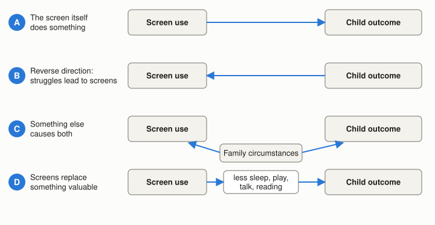

# Summary {.unnumbered #summary}

**Neither slogan fits.** For tablet and TV use in children of around six, the best available evidence shows small average links with weaker language, thinking skills and behaviour. Those links shrink in better-designed studies, and part of them runs the other way: children who are already struggling tend to be given, or to seek, more screens. No inspected study shows that ordinary amounts of use damage the developing brain, and brain-scan studies cannot show that screens caused the differences they report.

"It is all a moral panic" also goes too far. Screens around bedtime go with shorter sleep; a randomised trial that swapped violent for educational programmes improved young children's behaviour without cutting viewing time; and a two-week trial of sharply cutting screens improved parent-rated behaviour. Well-designed educational programmes have measurable benefits, mostly in children younger than six.

So the public debate is right about sleep, content and what screens crowd out. It overshoots on brain damage, falling IQ and precise hourly limits, and it undershoots on the differences between kinds of screen use.

For household rules, the evidence supports, in descending order of confidence: keeping the hour before bed and the bedroom screen-free; choosing content before counting minutes; and joining in when practical. No specific number of minutes is supported by evidence, although French guidance offers about two hours of leisure screen time a day as a marker for ages 6–11. Evidence specific to six-year-olds is thin: most findings are extrapolated from younger or older children and are associations rather than demonstrated effects.

<!-- RESEARCH_BODY_START -->

# 1. The short answer and what it means for household rules {#short-answer}

## Q0. How strong is the evidence, and does public concern match it? {#q0}

**Answer.** The evidence is good that links exist, and that they are small on average. It is weak on whether ordinary tablet and TV use *causes* lasting harm to a six-year-old's brain or thinking, and on balance it points away from large effects. The evidence for benefit is real but narrow: it concerns purpose-built educational content, mostly for children under six. Evidence for "no meaningful difference" at moderate amounts cannot be ruled in or out at age six, because no studies that could settle it were found.

Public concern is partly justified and partly inflated. Section [Q5](#q5) sets out where each is true.

*Confidence words used in this report.* These are this review's own judgements, not a formal grading. **Moderate**: several independent studies agree, at least some with designs that can address cause, or a consistent pattern with a clear reason to believe it. **Limited**: a few studies, or only associations, or evidence from other ages. **Insufficient**: the evidence inspected cannot support a conclusion either way. No claim in this report reaches **strong** for the question of harm at age six.

## Q7. Which family rules does the evidence support? {#q7}

**Answer.** Table 1 sets out the options with what supports each, how confident one can be, and what each costs. They are conditional options rather than instructions: which ones are worth adopting depends on the child's sleep, behaviour and what screens are actually displacing in that household. Sections [Q1](#q1) to [Q6](#q6) give the evidence behind each row.

| Option | What supports it | Confidence for around age 6 | Cost or trade-off |
|:-----------|:---------------------|:------|:------------|
| **Screen-free hour before bed; no screens in the bedroom** | Bedtime use and devices in the bedroom go with shorter sleep from age 6 upward; every health body inspected that addresses this advises it. But a two-week trial found no change in sleep. ([F9](#f9)) | Moderate that the link is real; limited that the rule alone lengthens sleep | Low. Bedtime routine and possibly the adult's own habits must change. |
| **Choose content first** (age-suitable, non-violent, educational or slower-paced) | A randomised trial in 3–5-year-olds improved behaviour by swapping content without cutting total viewing. Designed educational content has measurable benefits. ([F6](#f6), [F8](#f8)) | Moderate for avoiding violent or age-unsuitable content; limited for pace | Needs some vetting of apps and programmes. |
| **Join in when practical** (ask questions, talk about it) | Viewing with an adult goes with better language; an experiment showed gains in 3-year-olds. ([F10](#f10)) | Limited at age 6 | Adult time. Not needed for every minute. |
| **Agree a time budget** (daily or weekly) | No study identifies a threshold. French public-health markers give about 2 hours of leisure screen time a day for ages 6–11; Sweden gives 1–2. Heavy use (more than 2 hours a day of TV at around 8–9) goes with lower reading scores later. ([F7](#f7), [F14](#f14)) | Insufficient for any exact figure; limited that very high use is worse | Simple and clear, but a number can miss what matters. A cheaper alternative is to check what screens are replacing. |
| **TV off when nobody is watching; screens off at meals** | Background TV and caregiver phone use during routines go with weaker outcomes, mostly under age 6. ([F10](#f10)) | Limited at age 6 | Low. |
| **Avoid making a screen the main way of calming upset** | In 3–5-year-olds, frequent soothing with a device went with more emotional difficulty six months later. ([F10](#f10)) | Limited | Requires other calming strategies; occasional use is not the concern. |
| **Keep to age ratings and watch for heavy gaming** | Results are mixed: heavy gaming is linked to later socio-emotional problems in both directions, with no link to school results in one study and small thinking-skill gains in another at ages 9–12. ([F5](#f5), [F6](#f6)) | Limited | Gaming is social for many children, so a blanket ban has a cost. |
| **Very strict limits or no screens until later** | One French author advises no screens before 6 and under an hour a day after;[[1]](#ref-1) the 2024 French expert commission advises against, or strictly limiting, screens until 6.[[2]](#ref-2) No inspected study shows harm from moderate use at age 6, and official French guidance permits supervised use from then. ([F14](#f14)) | Insufficient as a health requirement; legitimate as a family preference | Gives up the benefits of good content, and may be hard to sustain. |
| **If something seems off, try a two-week reduction** | A randomised trial of a sharp cut improved parent-rated behaviour in two weeks. The children were older on average (about 9), and parents knew they were in the cut group. ([F5](#f5)) | Limited for lasting benefit | Demanding but short, and it answers the question for this child. |

: **Table 1.** Options for household rules, with the supporting evidence and confidence for children around age six.

# 2. What was reviewed and how {#scope}

**Scope.** This report covers children of about 3–12, weighted toward ages 5–8, using tablets, TV and video at home, including games and educational apps. Outcomes are brain development and thinking skills (attention, language, self-control, learning, behaviour) plus sleep. Teenagers and social media, classroom technology, eyesight, weight, and diagnosis or treatment of conditions such as ADHD or autism are outside it. Studies were not restricted to France, but French data and French guidance are singled out because the findings are meant to apply to a child of six living there.

**Terms used below.**

- *Screen time*: hours of use, usually reported by parents. The term lumps together very different activities.
- *Association* or *link*: two things go together. It does not say one causes the other.
- *Cohort study*: following the same children over years, which shows what comes first but can't rule out other causes.
- *Randomised trial*: children or families are assigned by chance to one condition or another. It is the best way to test cause, since chance makes the groups alike in everything else.
- *Meta-analysis*: a statistical combination of many studies. It is as good as the studies it combines.
- *Correlation (r)*: a number from −1 to +1 for how strongly two things go together; zero means no link. Research convention treats 0.1 as small, 0.2 as medium and 0.3 as large.[[3]](#ref-3) (Methods)
- *Effect size (d or g)*: a difference between groups, in units of the typical spread between children (the "standard deviation"). By common convention 0.2 is small and 0.5 is medium.
- *b or β*: how much one measure predicts another in a follow-up study, on a standardised scale. The values in this report, around 0.06, are small.
- *95% CI (confidence interval)*: the range of values reasonably compatible with the data.

**How the evidence was gathered.** This is a structured narrative review, not an exhaustive one. On 9 November 2026, web searches covered combined analyses and cohort studies of language, attention, self-control, behaviour, learning and sleep; brain imaging; randomised trials of reducing or changing screen use; educational television and apps; displacement of other activities; the history of media panics; and French and international guidance. Priority went to meta-analyses, cohort studies and experiments. Searching stopped when further queries returned already-known studies or adjacent populations and seemed unlikely to change the answers. No long-term trial of screen rules in six-year-olds was found.

**Access limits.** Full text or a complete PDF was read for the most important sources where available. Many journal articles are paywalled or could not be opened; for those, an abstract, a repository record or a news summary was read instead. Each reference states which. The review was done by one reviewer, with no second screening and no independent validation.

**Evidence specific to age six.** Direct evidence is thin. The closest inspected are the French ELFE cohort at 5½ years,[[4]](#ref-4) a small German study at 6–10,[[5]](#ref-5) an Australian cohort following 6-year-olds' sleep to 8,[[6]](#ref-6) and analyses that include ages 6–10.[[7]](#ref-7) Most combined results come from children under six (or under 12 on average), and most imaging from ages 3–5 or 9–10. Claims about six-year-olds below are extrapolations unless the text says otherwise.

# 3. Why a link is not yet a cause {#why-link}

### F1 · The main difficulty: four explanations fit the same pattern {#f1}

Suppose children who watch more also have weaker language. Figure 1 shows four explanations that all produce this pattern, and only the first says the screen itself does the harm. Telling them apart is the central task for this literature, because they imply different household decisions.

{fig-alt="Four rows of boxes. Row A: an arrow from screen use to child outcome. Row B: an arrow from child outcome back to screen use. Row C: family circumstances with arrows to both screen use and child outcome. Row D: screen use leads to less sleep, play, talk and reading, which leads to the child outcome."}

Evidence that explanations B and C are at work comes from studies that improve their design. In a meta-analysis of 87 studies of children up to 12 (159,425 children), the link between screen time and "externalising" behaviour (acting-out problems such as aggression and hyperactivity) was r = 0.13 in snapshot studies, 0.11 in follow-up studies that did not account for the child's starting behaviour, and 0.06 in follow-up studies that did.[[8]](#ref-8) (Table 1) The link was also smaller in higher-quality studies and in newer ones.[[8]](#ref-8) (Table 2) The pattern is what one would expect if part of the raw link comes from something other than screens.

Direction also runs both ways. A 2025 meta-analysis of 117 long-term studies (292,739 children under 10) found the same small effect in each direction: screen use predicting later socio-emotional problems (b = 0.06) and those problems predicting later screen use (b = 0.06).[[7]](#ref-7) (abstract) An earlier Canadian cohort of 2,441 children, however, found screens predicting later development scores (β = −0.06 to −0.08) and no significant reverse path.[[9]](#ref-9) The two findings can coexist; the Canadian children were younger (2–5 years) and the outcome was different.

Measurement adds another layer of uncertainty. Almost every study relies on parents' estimates of screen time.[[3]](#ref-3) (Limitations) [[8]](#ref-8) (p. 400) Across research on media use in general, self-reports correlate only moderately with logged use and were "rarely" accurate.[[10]](#ref-10) (abstract) Random error tends to make effects look smaller than they are, while reports coloured by how a parent sees the child could push results in either direction (this review's reasoning).

**Making "small" concrete (this review's calculation).** Squaring a correlation gives the share of the differences between children that it accounts for "statistically". For r = 0.11, that is 1.2% (0.11 × 0.11). For r = 0.06, it is 0.4%. A second way to read it: imagine dividing children evenly into higher and lower screen use, and into more and fewer behaviour problems. A correlation of 0.11 corresponds to about 55.5 of 100 heavier users being in the "more problems" half, against 44.5 of 100 lighter users; a correlation of 0.06 corresponds to 53 against 47. These are illustrations of the size of the statistic, not observed percentages. Small does not mean meaningless: the authors of the language meta-analysis point out that small effects can matter when almost every child is exposed.[[3]](#ref-3) (Discussion) But it does mean screen time alone tells a parent very little about a particular child.

# 4. Evidence on each question {#findings}

## Q1. What can brain-scan studies show, and do they show cause? {#q1}

**Answer.** Brain-scan studies can show that children with different screen habits have, on average, somewhat different brains. They cannot on their own show that screens caused the differences or that the differences are harmful. Confidence in that limit: moderate. On the specific findings: limited, as several sources could be read only in abstract or press form.

### F2 · Brain differences exist; their cause and meaning are unknown {#f2}

*Neuroimaging* means taking pictures or recordings of the brain: MRI shows structure, diffusion imaging shows the wiring ("white matter"), and EEG records electrical activity. These methods reveal differences between groups, usually at one point in time.

The study most often quoted in the press scanned 47 children aged 3–5 and found that higher scores on a parent questionnaire about screen use went with lower white-matter "integrity" measures in several brain tracts, after accounting for age and income.[[11]](#ref-11) It was a snapshot, the families were mostly well off, and only 68% of children gave usable scans. The authors state that the findings are correlational and do not identify cause. The associated thinking-test results also lost statistical significance once household income was taken into account, which shows how entangled family circumstances are with screen use.[[11]](#ref-11)

Larger studies point the same way. In the US ABCD study of 4,277 children aged 9–10, screen patterns related to differences in brain structure, but the associations with thinking-test scores were very small (effect sizes 0.04–0.1).[[12]](#ref-12) (abstract) A Japanese study found that more TV predicted *more* grey matter in some frontal areas, together with lower verbal IQ.[[13]](#ref-13) (abstract) That result illustrates why "different" cannot be read as "better" or "worse": more brain tissue is not automatically good. A scoping review of 33 studies from infancy to 12 reported both positive and negative differences, naming the prefrontal cortex (which supports planning and self-control) as most affected.[[14]](#ref-14) (abstract) In a Singapore cohort of 506 children, more screen time at 12 months went with differences in brain electrical activity and weaker attention and planning at age 9; family stresses may explain part of this, and the screen exposure was at a very different age from the one of interest here.[[15]](#ref-15) (press release)

Every sustained experience changes the brain, including reading or playing a sport, so finding a change is not in itself evidence of harm. None of the individual imaging studies read for this report randomly assigned children to screen use, and none focused on six-year-olds.

## Q2. Effects on attention, language, self-control, learning and behaviour {#q2}

**Answer.** Average links are small and mostly negative for heavier use, and the better the study the smaller the link. A few designs that can show cause find immediate effects of fast-paced cartoons, short-term behaviour gains from cutting screens, and modest learning gains from designed content. Table 2 summarises sizes. Confidence: moderate that effects are small on average; limited for anything specific to age six.

| Outcome | Finding | Size in plain words | Can it show cause? |
|:-------|:------------------|:----------|:--------|
| Language (mostly under 6) | Time on screens r = −0.14 (42 studies, 18,905 children); background TV r = −0.19 [[3]](#ref-3) (Results) | Small | No. Mostly parent reports |
| Thinking skills in France at 5½ | Per extra hour a day: −0.47 points on a scale where 15 points is the typical spread; followed from 3½ to 5½: −0.31 (could be zero) [[4]](#ref-4) (Table 3) | Very small: about 3% of the typical spread | No, but careful adjustment |
| Attention | Media use and ADHD-related behaviours r = 0.12 (45 studies; children and teens) [[16]](#ref-16) (abstract); ADHD symptoms r = 0.09 [[8]](#ref-8) (Table 1); no significant link with lab attention tests at 6–10 (61 children) [[5]](#ref-5) | Small to none | No |
| Self-control (immediately after viewing) | 9 minutes of a fast-paced cartoon lowered scores compared with drawing in 60 four-year-olds [[17]](#ref-17) | Short-term; unknown how long it lasts | Yes, but one small trial |
| Behaviour problems | Acting-out r = 0.11 overall, 0.06 with starting behaviour controlled; inward problems (anxiety, low mood) r = 0.07 [[8]](#ref-8) (Figs 2–3, Table 1) | Small to very small | Partly |
| Behaviour after cutting screens | Two weeks at ≤3 hours a week: 1.67 points better on a parent-rated difficulties scale (d = 0.53) [[18]](#ref-18) (Results) | Moderate, short-term | Yes, but parents knew their group |
| School results | Overall screen time: no significant link; TV: effect size −0.19 across school scores, about −0.2 for children's language (news summary) [[19]](#ref-19); TV over 2 hours a day in Grade 3 went with about 4 months less reading progress by Grade 5 [[20]](#ref-20) | Small | No |
| Thinking skills at 9–12 | Over two years: gaming +2.55 IQ points; watching +1.8, not robust; socialising no change [[21]](#ref-21) (Results) | Small, positive | Limited |
| Learning from designed content | *Sesame Street*: d = 0.29 in 24 studies [[22]](#ref-22) (Table); educational apps: g = 0.31 overall, 0.17 at school age and on standard tests [[23]](#ref-23) | Small to moderate | Mostly yes, with limits |

: **Table 2.** Effects on child outcomes, with sizes in plain words. Different effect-size types (r, d, g) are not directly comparable.

### F3 · Language and thinking skills: small negative links, positive for some kinds of use {#f3}

Figure 2 shows the main combined results for children mostly under six. Overall time and background TV sit on the negative side. Watching with an adult and watching educational programmes sit on the positive side, and they are as large as the negative ones.

{fig-alt="Dot plot with confidence intervals. Language: time on screens minus 0.14, background TV minus 0.19, educational programmes plus 0.13, watching with an adult plus 0.16. Thinking skills: programme viewing minus 0.16, background TV minus 0.10, using screens with an adult plus 0.14."}

The French ELFE cohort is the most applicable source, with 13,763 children followed from birth and screen time averaging 1.4 hours a day at age 5½.[[4]](#ref-4) (Results) After accounting for a long list of family and lifestyle factors, an extra hour a day went with 0.47 points less on a parent-rated development score at 5½, about 3% of the typical spread between children.[[4]](#ref-4) (Table 3) The longitudinal estimate from 3½ to 5½ was smaller and not distinguishable from zero. On the only test given by a trained investigator rather than rated by a parent, screen time went slightly the other way (+0.39 points at 3½), which the authors flag as unexpected.[[4]](#ref-4) (Table 3, Discussion) They conclude that the true causal effect is likely to be small.[[4]](#ref-4) (p. 10) A systematic umbrella review of 102 meta-analyses agrees on the overall pattern of small links for language, with a positive sign when parents watch too, while noting that 95 of the 102 had medium-to-high risk of bias.[[24]](#ref-24) (abstract)

### F4 · Attention and self-control: fast pace is suggestive, long-term harm undemonstrated {#f4}

A widely cited experiment in 60 four-year-olds found that nine minutes of a very fast cartoon, compared with a slower educational one or with drawing, was followed by poorer scores on planning and self-control tasks.[[17]](#ref-17) The authors could not separate pace from fantastical content and could not say how long the effect lasted. Later work using specially made videos that differed only in pace found more unsettled play afterwards.[[25]](#ref-25) (abstract) Pace may matter for young children in the short term. Whether it shapes lasting attention in a six-year-old is not established.

Studies at age 6–10 are few. A German laboratory study found no significant link between parent-reported screen time and objective attention tests, though it was small and from one school.[[5]](#ref-5) The combined link between media and ADHD-type behaviours is small; those studies include teenagers and cannot show direction.[[16]](#ref-16) (abstract)

### F5 · Behaviour: small two-way links, plus one trial showing a short-term gain from cutting screens {#f5}

Screen time and behaviour problems go together slightly, and problems also lead to more screens ([F1](#f1)). Age appears to matter: a 2025 meta-analysis reports stronger links at 6–10 than at younger ages (press summary).[[7]](#ref-7) (press summary) Gaming stood out, with links several times larger than for overall screen use in both directions (b = 0.32 from gaming to later problems; b = 0.44 from problems to more gaming), though this sits alongside the mixed evidence in [F6](#f6) and the review's authors note that factors such as parenting style could explain part of these links.[[7]](#ref-7) (abstract and press summary)

The most direct test comes from Denmark. Eighty-nine families (181 children, average age about 9) were randomised to continue as normal or to cut leisure screen use to no more than three hours a week for two weeks, handing over phones and tablets. Parent-rated difficulties fell by 1.67 points more than in the control group (d = 0.53) and helpful, considerate behaviour rose.[[18]](#ref-18) (Results) This is real evidence of cause, but with limits: parents knew which group they were in and rated the outcome themselves, it lasted two weeks, volunteer families may be unusually motivated, and the cut was far sharper than most households would attempt.

### F6 · Learning: TV-heavy childhoods score somewhat lower; designed content helps; no large IQ effects either way {#f6}

School results tend to be slightly lower with more TV, and overall screen time shows no significant link in one combined analysis of ages 4–18 (known here from a news summary).[[19]](#ref-19) In an Australian cohort of 1,239 children, more than two hours a day of TV in Grade 3 (about age 8–9) went with about four months less reading progress by Grade 5, while video games showed no link (also from a summary).[[20]](#ref-20)

Designed educational content is where the positive evidence is strongest. A meta-analysis of *Sesame Street*'s effects across 15 countries found gains of about 0.29 standard deviations in children aged 3–6, with the four true experiments among the studies showing 0.38; the analysis was commissioned by Sesame Workshop, using mostly its internal reports, though the authors had full access regardless of findings.[[22]](#ref-22) When *Sesame Street* first aired, US children in areas with better reception were more likely to be at the right grade for their age in school; estimates for long-term outcomes were imprecise.[[26]](#ref-26) (abstract) Older natural experiments point the same way: US children who could watch more television before school age did not score worse as teenagers, and the estimated effect was slightly positive, about 0.02 standard deviations per year of exposure.[[27]](#ref-27) (abstract) These concern broadcast TV decades ago, so transfer to tablets is uncertain.

For apps, 36 mostly randomised studies found average gains of 0.31 standard deviations in literacy and maths from preschool to Grade 3.[[23]](#ref-23) The gains were smaller at school age (0.17 versus 0.35 in preschool) and on standard tests (0.17, versus 0.43 on researcher-made tests), and 92% of the apps were used in schools rather than at home. Correcting for likely unpublished studies lowers the average to 0.20. Evidence for unsupervised app use at home is thinner still.

In the large US ABCD study of children followed from 9–10 to 11–12, heavier gaming at the start went with larger two-year gains on a thinking-skills composite (+2.55 IQ points), with genetic differences and family background taken into account. Watching showed a smaller gain that lost statistical significance under a different family-education measure, and socialising had no effect.[[21]](#ref-21) (Results) Screen time was self-reported and the study did not randomise, so this does not prove games make children smarter. It is, however, hard to reconcile with claims of widespread cognitive damage.

## Q3. Do effects depend on amount, content, timing and adult involvement? {#q3}

**Answer.** Yes, for content, timing and adult involvement; amount matters less clearly and has no identifiable threshold. Confidence: moderate for sleep timing and for content; limited for co-viewing at age six and for amount.

### F7 · Amount: no safe or dangerous threshold has been identified {#f7}

No inspected source identifies a safe or a dangerous number of hours. On children's and adolescents' mental health, France's High Council for Public Health reported a dose-effect relationship, but said no threshold could be identified and no causal relationship had been demonstrated.[[28]](#ref-28) (p. 20) The UK's 2026 expert panel, reviewing under-fives, also finds no clear safe threshold. It says its recommendation of about an hour a day is "not based directly on evidence" but on child-development knowledge and other guidance, while finding "little evidence of harm" below one hour for children aged two and over.[[29]](#ref-29) (p. 31) In the French ELFE cohort the relationship was roughly linear at 3½ and 5½ years, meaning each hour adds a small amount rather than a sudden step.[[4]](#ref-4) (Discussion p. 9) The evidence that heavy use is worse than moderate use is more convincing than the evidence for any line between them. Australia's finding of about four months' reading difference at more than two hours of TV a day in Grade 3 is the closest inspected data for school age, and it comes from a single observational study.[[20]](#ref-20)

For scale, French children aged 3–5 spend about 1 hour 30 minutes a day on screens and those aged 9–11 about 2 hours 30,[[30]](#ref-30) so a typical six-year-old probably sits between these (this review's inference from the two age groups).

### F8 · Content: the most clearly causal evidence {#f8}

The strongest single study about content is a Seattle trial of 565 families with 3–5-year-olds.[[31]](#ref-31) (abstract) Parents were helped to replace aggressive programmes with high-quality prosocial and educational ones, without any attempt to reduce total viewing time. Six months later the children scored 2.11 points better on a social-competence and behaviour measure (95% CI 0.78 to 3.44), and the effect sizes had not noticeably shrunk at 12 months. Low-income boys benefited most. The effect is modest, but this was a randomised comparison, and it shows that *what* is watched matters independently of *how long*. Combined analyses of children up to six agree: age-unsuitable content goes with poorer psychosocial outcomes (r = −0.11).[[32]](#ref-32) (abstract)

Fast-paced, frenetic content is flagged by the UK panel as a concern for under-fives,[[29]](#ref-29) (pp. 8–9, 23) resting on experiments like [F4](#f4), but the evidence does not yet extend to older children or to short-form video in this age group. Educational design matters more than the label "educational": see [F6](#f6).

### F9 · Timing: the hour before bed {#f9}

Sleep is the area with the most consistent direction of evidence. A meta-analysis of 125,198 children and teenagers aged 6–19 found that using a device near bedtime went with roughly double the odds of too little sleep (odds ratio 2.17, 95% CI 1.42–3.33), and that simply having a device in the bedroom also raised the odds (1.79, 1.39–2.31).[[33]](#ref-33) (results tables) To give a sense of scale (hypothetical baseline): if 20% of children without bedtime devices slept too little, an odds ratio of 2.17 would correspond to about 35% among bedtime users (0.25 odds × 2.17 = 0.54 odds, which is 35%). The authors rated the evidence as low quality: all studies were snapshots, and results varied a great deal.

At ages closer to six, the link runs both ways. In 3,427 Australian children, more media use at 6 predicted slightly less sleep at 8 (β = −0.06), and less sleep at 6 predicted slightly more media use at 8 (β = −0.08).[[6]](#ref-6) A small experiment in 36 children aged 3–5 found that bright light from a light table in the hour before bed reduced the sleep hormone melatonin by 70–99%. This comes from a news report of the study; the light table is not a tablet, and each child had one exposure.[[34]](#ref-34) (news summary) In preschoolers, evening use, violent or scary content and a TV in the bedroom went with more sleep problems.[[35]](#ref-35) (news summary)

A counterweight: in the Danish trial described in [F5](#f5), two weeks of cutting screens made no significant difference to children's measured sleep, although non-sedentary activity rose.[[36]](#ref-36) (summary) That may reflect the short period or the children's already adequate sleep (about 9 hours), or it may be that *when* screens are used matters more than total time (this review's reading). Reports from the Seattle trial described in [F8](#f8) also said that its content change improved sleep, but only an abstract fragment and a press account could be read, so no figures are given here.[[37]](#ref-37) (press report)

### F10 · Adults: joining in, background TV and soothing {#f10}

Children who watch with a parent have somewhat better language (r = 0.16, 12 studies) and thinking skills (r = 0.14, 8 studies).[[3]](#ref-3) (Results) [[32]](#ref-32) (abstract) Parents who watch with their children may also differ in other ways, so experiments matter. In one with 81 families, parents of 3-year-olds were trained to pause and ask questions during story videos, and after four weeks their children did better on story comprehension and vocabulary than those with no intervention.[[38]](#ref-38) (abstract) The evidence base is narrow: the UK panel found only 7% of 622 under-five studies assessed who the child watched with, and 10% what they watched.[[29]](#ref-29) (pp. 17–18) For a six-year-old it can be expected to matter less than at three, but this has not been tested (this review's inference).

Background TV goes with worse language (r = −0.19) and thinking skills (r = −0.10) at younger ages.[[3]](#ref-3) (Results) [[32]](#ref-32) (abstract) In France, having the TV on during family meals at age 2 went with lower vocabulary at that age, more than ten times the effect of an extra hour of screen time.[[4]](#ref-4) (Table 3, Discussion p. 10) Adult screen use during routines goes with poorer social and emotional outcomes (r = −0.11).[[32]](#ref-32) (abstract) Frequent use of a device to calm a child aged 3–5 went with more emotional dysregulation six months later, especially in boys and more temperamental children; occasional use is not the concern.[[39]](#ref-39) (press release)

## Q4. How much comes from what screens replace? {#q4}

**Answer.** Evidence is insufficient to give a share. Displacement is the mechanism health bodies consider most likely, and there is supporting evidence, but no study has measured what fraction of any effect it explains. Confidence that it matters at all: moderate. Confidence in any number: insufficient.

### F11 · Displacement is plausible and partly supported, but unmeasured as a share {#f11}

The UK's paediatric college judges displacement of healthy activities to be the main link between screens and health,[[40]](#ref-40) (p. 4) and the UK panel reaches a similar view for under-fives.[[29]](#ref-29) (p. 23)

The direct evidence is suggestive. In a study of 220 Australian families with children aged 12–36 months, each extra minute of screen time at 36 months went with 6.6 fewer adult words, 4.9 fewer child vocalisations and 1.1 fewer conversational turns.[[41]](#ref-41) (news summary) In a Japanese cohort of 885 children, more screen time at age 2 went with less outdoor play and weaker later communication and daily living skills, and outdoor play accounted for part of the daily-living-skills link.[[42]](#ref-42) (summary) When the Danish trial cut screens, children's non-sedentary activity rose by about 45 minutes a day, which shows that time freed from screens really is used differently.[[36]](#ref-36) (summary)

The closest numerical hint for older children comes from the French ELFE cohort. Adding lifestyle factors (play, outdoor time, sleep, shared leisure and childcare) to the analysis shrank the link at 5½ from −0.80 to −0.47 points, a fall of about 41% ((0.80 − 0.47) ÷ 0.80; this review's calculation).[[4]](#ref-4) (Table 3) But this cannot isolate displacement: those factors could be things screens replace, or simply features of the sort of family that uses more screens.

Evidence on what screens displace in six- to eight-year-olds specifically, including reading, was not found in this review. School also takes up the day at this age, which changes what is available to displace (this review's inference). The most practical implication: the household question "what would this child be doing otherwise?" can be answered by a family even when science cannot answer it for children in general.

## Q5. Does the debate resemble past media panics, and where does it overreach? {#q5}

**Answer.** Yes in its form, and partly in its excesses. But resemblance does not settle whether the concern is right: some concerns about screens are better supported than past panics were. Confidence: moderate on the pattern; moderate on the specific overreaches.

### F12 · The pattern repeats {#f12}

Concern about children and new media has recurred with novels, film, radio, comics, television and video games. Each medium arrived with hopes of education and fears about violence, sex and lost time.[[43]](#ref-43) [[44]](#ref-44) (abstract) Psychologist Amy Orben describes a repeating cycle: public worry prompts funding and policy debate, researchers are asked to reassure or warn, research lacks a shared framework and so starts again with each new technology.[[44]](#ref-44) (abstract)

The comics episode shows how badly this can go. Fredric Wertham's 1954 book, *Seduction of the Innocent*, helped push the US comics industry into self-censorship. Decades later, an analysis of his private papers found he had altered children's ages and quotes and left out other explanations (read here through a secondary account).[[45]](#ref-45) (secondary account)

### F13 · Where claims go beyond the evidence, on both sides {#f13}

**"Screens are destroying the brain."** Brain scans show differences, not damage ([F2](#f2)). The most careful French cohort estimates a small effect ([F3](#f3)).

**"Screens are the cause of falling IQ."** A French bestseller and its coverage popularised the claim that intelligence is falling and that screens are to blame.[[1]](#ref-1) The best-known Norwegian data do show declining scores in men born after about 1975, due to environmental change within families; the authors could not identify the cause and list media exposure among many hypotheses, without testing it.[[46]](#ref-46) The decline began with men born around 1975 and was measured up to the 1991 birth cohort, children who grew up well before tablets existed. Television and video games were around, so this does not clear media in general, but the decline does not by itself implicate screens.

**"Screens cause autism."** In 2017 a French clinician's reports linking heavy early screen use to autism-like symptoms circulated widely. Researchers objected at the time that there was no comparison group, that family factors were not ruled out, and that causation may run the other way.[[47]](#ref-47) Diagnosis is outside this review's scope, but the episode illustrates how a clinical concern can run ahead of evidence.

**A precise number of minutes.** Guidance such as "one hour" reads as if it marks a line. The panel behind the UK's figure says it is not based directly on evidence.[[29]](#ref-29) (p. 31)

**"It's only a moral panic."** This overreaches too. The UK paediatric college's 2019 statement that the idea of direct toxicity "has essentially no evidence to support it"[[40]](#ref-40) (p. 4) sits alongside its own concern about sleep. A later randomised trial found real short-term behaviour change from cutting screens ([F5](#f5)), and content effects are experimentally demonstrated ([F8](#f8)). Today's media also differ from past ones in being personal, always on and designed to hold attention, which is a central concern of the American Academy of Pediatrics.[[48]](#ref-48) The historical pattern is a reason for caution about alarm, not proof that no harm exists.

France's own public-health agency reflects this balance. Its October 2026 dossier treats sleep and physical effects as established, calls mental-health evidence incomplete, and argues for proportionate rather than alarmist prevention, with one article suggesting cognitive risks at 0–6 should be kept in perspective when use is supervised.[[30]](#ref-30)

## Q6. What do French and international health bodies recommend, and on what evidence? {#q6}

**Answer.** Bodies agree on sleep, on the importance of content and adult presence, and on avoiding screens for the very youngest. They disagree on numbers, and several openly acknowledge that their limits are precaution rather than proven thresholds. For age six, French advice permits supervised use with clear rules. Confidence that this describes current guidance: moderate, because some documents were read through secondary sources.

### F14 · Guidance converges on behaviour, diverges on numbers, and rests on weak evidence {#f14}

| Body and date | For age 6 or nearest | Evidence basis stated |
|:-----------|:-------------------|:---------------|
| **France: official advice**, updated March 2026 [[49]](#ref-49) | From 6, may start with supervised use, clear rules, time and content monitoring, breaks; no screens at meals, in bedrooms, or for one hour before sleep | Cites 2024 expert report and carnet de santé (health booklet) |
| **France: carnet de santé**, from January 2025 [[50]](#ref-50) | Under 3: no screens. 3–6: occasional, educational, with an adult | Not stated in the source read |
| **France: expert commission report**, April 2024 (read through a third-party synthesis) [[2]](#ref-2) | 6–10: "moderate and controlled" exposure. Under 6: advises against or strictly limit | Evidence described mostly in hedged terms; effects at 6–17 "to be confirmed". Declines to set a daily time limit; suggests a weekly limit |
| **France: HCSP report**, January 2020 [[28]](#ref-28) | Limit and plan screen use; no screens in the bedroom; none in the hour before sleep | "Weak to moderate" evidence under 6 (p. 24); for mental health, no threshold or causal link shown (p. 20); precautionary principle where data are lacking (p. 24) |
| **France: PNNS and Anses markers** (as cited in HCSP) [[28]](#ref-28) (pp. 6–7) | PNNS, ages 6–11: no more than about 2 hours a day of leisure screens. Anses, ages 6–17: no more than 2 hours at a stretch | Numeric markers; not derived from a demonstrated threshold |
| **WHO**, 2019 [[51]](#ref-51) [[52]](#ref-52) (p. 98) | Applies only under age 5: ages 2–4, no more than 1 hour | Update found 15 additional sedentary studies, 4 long-term, none experimental |
| **American Academy of Pediatrics**, 2026 [[48]](#ref-48) [[53]](#ref-53) | No numeric limit. Family media plan; screen-free bedrooms, meals; no screens for an hour before bed | Moved "beyond simple screen-time limits"; focus on platform design |
| **UK RCPCH**, 2019 [[40]](#ref-40) (pp. 4, 6, 7–9) | No cut-off. Four family questions; avoid screens for an hour before bed | "Unable to recommend a cut-off" |
| **UK early years guidance**, March 2026 [[29]](#ref-29) | Under-5s only: ages 2–5, about 1 hour a day | "Not based directly on evidence" (p. 31); trials of cutting screens in under-fives have not looked at child development (pp. 31–32) |
| **Sweden**, September 2024 [[54]](#ref-54) | Ages 6–12: 1–2 hours a day | Agency evidence review; a minister acknowledged incomplete knowledge |

: **Table 3.** Recommendations for children around six (or nearest age group) from French and international bodies, with the evidence each cites. Sources marked as such in the bibliography were read through secondary accounts.

Two features stand out for a six-year-old in France. First, most of the strictest and best-known limits (WHO, UK) apply only below age five, so citing them for a six-year-old stretches them. Second, the French body of advice speaks with more than one voice: the HCSP and Anses-based markers give a daily figure, while the 2024 commission declined to set one because screen time is an imperfect measure and a daily allowance implies daily use is fine.[[2]](#ref-2) A family choosing a number is making a reasonable choice under uncertainty; it is not applying a scientific threshold. The sleep, bedroom and mealtime rules are the ones on which almost everyone agrees.

# 5. Limitations of the evidence and of this review {#limitations}

**In the evidence.** Few studies directly address children around six; extrapolations from under-fives and 9–12-year-olds carry through this report. Almost all exposure data are parent-reported.[[10]](#ref-10) (abstract) "Screen time" lumps together activities with different effects, and few studies measure content or context, as the UK panel's counts show.[[29]](#ref-29) (pp. 17–18) Much of the evidence predates tablets.[[3]](#ref-3) (Limitations) Randomised trials are few, short and mostly in other age groups. No inspected source reports the trial that would be most informative, following children for years after assigning different screen rules; the UK panel says studies of cutting screen time in under-fives have not looked at child development, and calls this a major knowledge gap.[[29]](#ref-29) (pp. 31–32) Effects on children with specific vulnerabilities could be larger than the averages reported here.

**In this review.** This is a one-reviewer narrative review, not a systematic one, and it applied no formal evidence grading. Because of paywalls and blocks on automated access, some key studies could be inspected only through abstracts, repository records, press releases or news summaries (flagged in each reference): notably Vasconcellos 2025, Mallawaarachchi 2024, Paulus 2019, Takeuchi 2015, Wu 2024, Law 2023, Adelantado-Renau 2019, Mundy 2020, Brushe 2024, Sugiyama 2023 and the Pedersen 2022 trial's sleep results. The French commission report was read through a third-party synthesis, not the original. Effect estimates from these sources could not be checked against underlying tables. Corrections or retractions were not searched for each study individually.

# 6. Conclusion {#conclusion}

For a child around six, the evidence does not support treating tablets and TV as a threat to brain development at ordinary levels of use, nor treating concern as baseless. The honest picture is small, entangled and two-directional associations, a few trials showing what changes when content or use is deliberately changed, and solid agreement among health bodies about protecting sleep. The rules with the best support are about when (not before bed, not in the bedroom), and what (suitable content), with adult involvement a useful addition. A number of minutes per day is a household convention to be chosen for practical reasons rather than a line that science has drawn.

The clearest gap is that no long-term randomised evidence on children of this age was found. Until it exists, the sensible stance is to treat firm claims of harm, and firm claims of harmlessness, with equal care.

<!-- RESEARCH_BODY_END -->

# References {.unnumbered #references}

Each entry states what was actually read. "Hosted copy" means the full text was read at the address of an institution or third party rather than from the publisher.

### [1] Michel Desmurget dénonce le temps passé sur les écrans {#ref-1}

Europe 1 interview article (undated page) about *La Fabrique du crétin digital* (2019). The book itself was not read. <https://www.europe1.fr/sciences/michel-desmurget-denonce-le-temps-passe-sur-les-ecrans-chez-les-adolescents-cest-extravagant-et-hors-norme-3920728>

### [2] Synthesis of: Enfants et écrans. À la recherche du temps perdu {#ref-2}

Guéant V. Third-party synthesis of the April 2024 report by the expert commission co-chaired by Mouton S and Benyamina A. The 142-page report itself was not read. <https://lafibre.info/images/doc/202404_synthese_enfants_et_ecrans_a_la_recherche_du_temps_perdu.pdf>

### [3] Associations Between Screen Use and Child Language Skills: A Systematic Review and Meta-analysis {#ref-3}

Madigan S, et al. 2020. *JAMA Pediatrics*. Peer-reviewed meta-analysis. Full text read. <https://pmc.ncbi.nlm.nih.gov/articles/PMC7091394/>

### [4] Associations of screen use with cognitive development in early childhood: the ELFE birth cohort {#ref-4}

Yang S, Saïd M, Peyre H, Ramus F, Taine M, Law EC, Dufourg MN, Heude B, Charles MA, Bernard JY. 2023. *Journal of Child Psychology and Psychiatry*. Peer-reviewed cohort study. Full text read. <https://doi.org/10.1111/jcpp.13887>

### [5] Screen Time and Attention Subdomains in Children Aged 6 to 10 Years {#ref-5}

Liebherr M, Kohler M, Brailovskaia J, Brand M, Antons S. 2022. *Children* 9(9):1393. Peer-reviewed cross-sectional study. Full text read. <https://doi.org/10.3390/children9091393>

### [6] Bidirectional relationships between sleep duration and screen time in early childhood {#ref-6}

Magee CA, Lee J, Vella SA. 2014. *JAMA Pediatrics* 168(5):465–470. Peer-reviewed cohort study. Abstract read. <https://ro.uow.edu.au/sspapers/1052>

### [7] Electronic Screen Use and Children's Socioemotional Problems: A Systematic Review and Meta-Analysis of Longitudinal Studies {#ref-7}

Vasconcellos RP, Sanders T, Lonsdale C, et al. 2025. *Psychological Bulletin* 151(5):513–543. Peer-reviewed meta-analysis. Abstract and press summaries read, full text not accessed. <https://doi.org/10.1037/bul0000468>

### [8] Association of Screen Time With Internalizing and Externalizing Behavior Problems in Children 12 Years or Younger {#ref-8}

Eirich R, McArthur BA, Anhorn C, McGuinness C, Christakis DA, Madigan S. 2022. *JAMA Psychiatry* 79(5):393–405. Peer-reviewed meta-analysis. Full text read in a hosted copy. <https://doi.org/10.1001/jamapsychiatry.2022.0155>

### [9] Association Between Screen Time and Children's Performance on a Developmental Screening Test {#ref-9}

Madigan S, et al. 2019. *JAMA Pediatrics* 173(3):244–250. Peer-reviewed cohort study. Full text read in a hosted copy. <https://pmc.ncbi.nlm.nih.gov/articles/PMC6439882>

### [10] A systematic review and meta-analysis of discrepancies between logged and self-reported digital media use {#ref-10}

Parry DA, Davidson BI, Sewall CJR, et al. 2021. *Nature Human Behaviour* 5:1535–1547. Peer-reviewed meta-analysis. Abstract read. <https://doi.org/10.1038/s41562-021-01117-5>

### [11] Associations Between Screen-Based Media Use and Brain White Matter Integrity in Preschool-Aged Children {#ref-11}

Hutton JS, et al. 2020. *JAMA Pediatrics* 174(1):e193869. Peer-reviewed cross-sectional study. Full text read in a hosted copy. <https://doi.org/10.1001/jamapediatrics.2019.3869>

### [12] Screen media activity and brain structure in youth: Evidence for diverse structural correlation networks from the ABCD study {#ref-12}

Paulus MP, et al. 2019. *NeuroImage* 185:140–153. Peer-reviewed cross-sectional analysis. Abstract read. <https://doi.org/10.1016/j.neuroimage.2018.10.040>

### [13] The Impact of Television Viewing on Brain Structures: Cross-Sectional and Longitudinal Analyses {#ref-13}

Takeuchi H, et al. 2015. *Cerebral Cortex* 25(5):1188–1197. Peer-reviewed. Abstract read. <https://doi.org/10.1093/cercor/bht315>

### [14] How early digital experience shapes young brains during 0–12 years: a scoping review {#ref-14}

Wu D, Dong X, Liu D, Li H. 2024. *Early Education and Development* 35(7):1395–1431. Peer-reviewed scoping review. Abstract and institutional record read. <https://doi.org/10.1080/10409289.2023.2278117>

### [15] Press release on screen time at age 1, brain activity and executive function at age 9 (GUSTO cohort) {#ref-15}

Law E, et al. 2023. Reported in *JAMA Pediatrics*; press release from NUS Medicine and A*STAR, 31 January 2023. Only the press release was read. <https://medicine.nus.edu.sg/wp-content/uploads/2023/01/NUSMedicine-AStar-Joint-release_Screen-time-and-cognitive-abilities-31JAN2023.pdf>

### [16] Media use and ADHD-related behaviors in children and adolescents: A meta-analysis {#ref-16}

Nikkelen SWC, Valkenburg PM, Huizinga M, Bushman BJ. 2014. *Developmental Psychology* 50(9):2228–2241. Peer-reviewed meta-analysis. Abstract read. <https://doi.org/10.1037/a0037318>

### [17] The Immediate Impact of Different Types of Television on Young Children's Executive Function {#ref-17}

Lillard AS, Peterson J. 2011. *Pediatrics* 128(4):644–649. Peer-reviewed randomised experiment. Full text read in a hosted copy. <https://uva.theopenscholar.com/files/early-development-lab/files/the_immediate_impact_8.pdf>

### [18] Screen Media Use and Mental Health of Children and Adolescents: A Secondary Analysis of a Randomized Clinical Trial {#ref-18}

Schmidt-Persson J, Rasmussen MGB, Sørensen SO, Mortensen SR, Olesen LG, Brage S, Kristensen PL, Bilenberg N, Grøntved A. 2024. *JAMA Network Open*. Peer-reviewed secondary analysis of a cluster randomised trial. Full text read. <https://doi.org/10.1001/jamanetworkopen.2024.19881>

### [19] News summary: Not all screen time negatively affects kids' academic achievement {#ref-19}

Healio, 26 September 2019, reporting Adelantado-Renau M, et al. *JAMA Pediatrics* 2019, doi:10.1001/jamapediatrics.2019.3176. Only the news summary was read. <https://www.healio.com/news/pediatrics/20190926/not-all-screen-time-negatively-affects-kids-academic-achievement>

### [20] Summary of: Electronic media use and academic performance in late childhood: A longitudinal study {#ref-20}

Royal Children's Hospital (Melbourne) blog, 7 September 2020, reporting Mundy L, et al. *PLOS ONE* 2020, doi:10.1371/journal.pone.0237908. Only the summary was read. <https://blogs.rch.org.au/cah/2020/09/07/computer-use-and-academic-results/>

### [21] The impact of digital media on children's intelligence while controlling for genetic differences in cognition and socioeconomic background {#ref-21}

Sauce B, et al. 2022. *Scientific Reports*. Peer-reviewed cohort analysis. Full text read. The paper gives two different follow-up counts (5,169 and 5,374). <https://doi.org/10.1038/s41598-022-11341-2>

### [22] Effects of Sesame Street: A meta-analysis of children's learning in 15 countries {#ref-22}

Mares M-L, Pan Z. 2013. *Journal of Applied Developmental Psychology*. Peer-reviewed meta-analysis. Full text read in a hosted copy. <https://s3.documentcloud.org/documents/24679693/mares-pan-2013-sesame-street-meta-analysis.pdf>

### [23] Measures Matter: A Meta-Analysis of the Effects of Educational Apps on Preschool to Grade 3 Children's Literacy and Math Skills {#ref-23}

Kim J, Gilbert J, Yu Q, Gale C. 2021. *AERA Open* 7(1):1–19. Peer-reviewed meta-analysis. Full text read. <https://doi.org/10.1177/23328584211004183>

### [24] An umbrella review of the benefits and risks associated with youths' interactions with electronic screens {#ref-24}

Sanders T, et al. 2024. *Nature Human Behaviour* 8(1):82–99. Peer-reviewed umbrella review. Abstract read from publisher PDF. <https://doi.org/10.1038/s41562-023-01712-8>

### [25] Examining the short-term effects of video exposure on children's attention and other cognitive processes {#ref-25}

Kostyrka-Allchorne K. 2018. PhD thesis, University of Essex. Abstract read. <https://repository.essex.ac.uk/21225/>

### [26] Early Childhood Education by Television: Lessons from Sesame Street {#ref-26}

Kearney MS, Levine PB. 2019. *American Economic Journal: Applied Economics* 11(1):318–350. Peer-reviewed. Abstract read. <https://econ.umd.edu/publicationprofile/7375>

### [27] Preschool Television Viewing and Adolescent Test Scores: Historical Evidence from the Coleman Study {#ref-27}

Gentzkow M, Shapiro JM. 2008. *Quarterly Journal of Economics* 123(1):279–323. Peer-reviewed. Abstract read. <https://econpapers.repec.org/RePEc:oup:qjecon:v:123:y:2008:i:1:p:279-323.>

### [28] Analyse des données scientifiques : effets de l'exposition des enfants et des jeunes aux écrans {#ref-28}

Haut Conseil de la santé publique (France). January 2020. Official report. First third of the document read, including summary and pp. 6–24. <https://vie-publique.fr/files/rapport/pdf/273315.pdf>

### [29] Screen use by children aged under five: independent report {#ref-29}

Early Years Screen Time Advisory Group (UK). March 2026. Official independent report. Most of the document read. <https://assets.publishing.service.gov.uk/media/69c53daf4a06660f085442a7/EYSTAG_report.pdf>

### [30] Grandir avec les écrans (La Santé en action no. 474) — summary page {#ref-30}

Santé publique France. 9 October 2026. Official dossier; summary page read. Includes data from the Enabee study. <https://www.santepubliquefrance.fr/les-actualites/grandir-avec-les-ecrans-le-dossier-de-la-sante-en-action-numero-474-de-juillet-septembre-2026>

### [31] Modifying Media Content for Preschool-Age Children: A Randomized Controlled Trial {#ref-31}

Christakis DA, Garrison MM, Herrenkohl T, Haggerty K, Rivara FP, Zhou C, Liekweg K. 2013. *Pediatrics* 131(3):431–438. Peer-reviewed randomised trial. Abstract read. doi:10.1542/peds.2012-1493. <https://socialwork.uw.edu/news/resource/modifying-media-content-preschool-children-randomized-controlled-trial/>

### [32] Early Childhood Screen Use Contexts and Cognitive and Psychosocial Outcomes: A Systematic Review and Meta-analysis {#ref-32}

Mallawaarachchi S, et al. 2024. *JAMA Pediatrics* 178(10):1017–1026. Peer-reviewed meta-analysis. Abstract read, full text not accessed. <https://doi.org/10.1001/jamapediatrics.2024.2620>

### [33] Association between portable screen-based media device access or use and sleep outcomes {#ref-33}

Carter B, Rees P, Hale L, Bhattacharjee D, Paradkar MS. 2016. *JAMA Pediatrics* 170(12). Peer-reviewed meta-analysis. Accepted manuscript read. <https://orca.cardiff.ac.uk/id/eprint/91557/>

### [34] News report: Light from screens before bed can disrupt preschoolers' sleep {#ref-34}

UPI/HealthDay, 31 January 2022, reporting Hartstein L, LeBourgeois M, et al. in *Journal of Pineal Research*. Only the news report was read. <https://www.upi.com/Health_News/2022/01/31/screens-bedtime-toddlers/8511643645483/>

### [35] Summary of: Media use and child sleep: the impact of content, timing, and environment {#ref-35}

Contemporary Pediatrics, reporting Garrison MM, Liekweg K, Christakis DA. *Pediatrics* 2011;128(1):29–35. Only the summary was read. <https://contemporarypediatrics.com/view/preschoolers-sleep-better-without-television-bedtime>

### [36] Effects of Limiting Recreational Screen Media Use on Physical Activity and Sleep in Families With Children {#ref-36}

Pedersen J, et al. 2022. *JAMA Pediatrics* 176(8):741–749. Randomised trial. Only summaries read (BMJ Evidence-Based Nursing commentary and news report). <https://doi.org/10.1001/jamapediatrics.2022.1519>; summary: <https://ebn.bmj.com/content/26/2/57>

### [37] Press report on: The Impact of a Healthy Media Use Intervention on Sleep in Preschool Children {#ref-37}

Education Week, August 2012, reporting Garrison MM, Christakis DA. *Pediatrics* 2012, doi:10.1542/peds.2011-3153. Only the press report and an abstract fragment read; no figures used. <https://www.edweek.org/education/study-says-age-inappropriate-media-content-affects-preschoolers-sleep/2012/08>

### [38] Effective coviewing: Preschoolers' learning from video after a dialogic questioning intervention {#ref-38}

Strouse GA, O'Doherty K, Troseth GL. 2013. *Developmental Psychology* 49(12):2368–2382. Peer-reviewed experiment. Abstract read. <https://busqueda.bvsalud.org/portal/resource/es/mdl-23544859>

### [39] Press release: Frequently using digital devices to soothe young children may backfire {#ref-39}

Michigan Medicine, via EurekAlert, December 2022, reporting Radesky J, et al. *JAMA Pediatrics*, doi:10.1001/jamapediatrics.2022.4793. Only the press release read. <https://www.eurekalert.org/news-releases/973907>

### [40] The health impacts of screen time: a guide for clinicians and parents {#ref-40}

Royal College of Paediatrics and Child Health (UK). January 2019. Professional guidance. Full text read. <https://www.justonenorfolk.nhs.uk/media/vxrhvmdh/rcpch_screen_time_guide_-_final.pdf>

### [41] News summary: Screen Time Linked to Decreases in Measures of Parent-Child Talk {#ref-41}

HealthDay, March 2024, reporting Brushe ME, Haag DG, Melhuish EC, Reilly S, Gregory T. *JAMA Pediatrics* 2024;178(4):369–375. Only the news summary read. <https://www.healthday.com/healthpro-news/child-health/screen-time-linked-to-decreases-in-measures-of-parent-child-talk>

### [42] Outdoor play as a mitigating factor in the association between screen time for young children and neurodevelopmental outcomes {#ref-42}

Sugiyama M, et al. 2023. *JAMA Pediatrics* 177(3). Cohort study. Only a summary read. <https://doi.org/10.1001/jamapediatrics.2022.5356>

### [43] A Brief History of Children and Media Research {#ref-43}

Wartella E. 25 January 2018. Workshop presentation slides, Northwestern University. <https://www.nichd.nih.gov/sites/default/files/2018-03/WartellaHistChildMediaResearch.pdf>

### [44] The Sisyphean Cycle of Technology Panics {#ref-44}

Orben A. 2020. *Perspectives on Psychological Science* 15(5). Peer-reviewed essay. Abstract read. <https://doi.org/10.1177/1745691620919372>

### [45] Secondary account of: Seducing the Innocent: Fredric Wertham and the Falsifications that Helped Condemn Comics {#ref-45}

Comic Book Legal Defense Fund, 2014, reporting Tilley C. *Information & Culture* 2012. Only the secondary account read. <https://cbldf.org/2014/01/censorship-2013-wertham-fabricated-evidence-against-comics/>

### [46] Flynn effect and its reversal are both environmentally caused {#ref-46}

Bratsberg B, Rogeberg O. 2018. *PNAS* 115(26):6674–6678. Peer-reviewed. Full text read in a hosted copy. <https://doi.org/10.1073/pnas.1718793115>

### [47] Ecrans et TSA, les éléments du débat {#ref-47}

Guernalec-Levy G. 23 March 2017. *Gynger* (French online magazine). Journalistic account. <https://www.gynger.fr/ecrans-et-tsa-les-elements-du-debat/>

### [48] Helping Kids Thrive in a Digital World: AAP Policy Explained {#ref-48}

American Academy of Pediatrics, HealthyChildren.org. Updated 3 June 2026. Explains the 2026 policy statement (DOI 10.1542/peds.2025-075320), which was not itself read. <https://www.healthychildren.org/English/family-life/Media/Pages/Helping-Kids-Thrive-in-a-Digital-World-AAP-Policy-Explained.aspx>

### [49] Écrans : des risques pour la santé physique et mentale des enfants, un accompagnement nécessaire {#ref-49}

Ministère chargé de la Santé et des Solidarités (France). Published 2 July 2025, updated 31 March 2026. Official guidance page. <https://solidarites.gouv.fr/enfants-et-ecrans-des-risques-sanitaires-reels-un-accompagnement-necessaire>

### [50] Catherine Vautrin ne veut plus que les enfants de moins de trois ans soient exposés aux écrans {#ref-50}

VIDAL / AFP, 17 June 2025. News report quoting the carnet de santé wording; the carnet itself was not read. <https://www.vidal.fr/actualites/31925-catherine-vautrin-ne-veut-plus-que-les-enfants-de-moins-de-trois-ans-soient-exposes-aux-ecrans.html>

### [51] Guidelines on physical activity, sedentary behaviour and sleep for children under 5 years of age {#ref-51}

World Health Organization. 2019. Official guideline (WHO/NMH/PND/2019.4). Hosted copy read in part; layout partly garbled. <https://blogcontent.summit-education.com/wp-content/uploads/WHO-NMH-PND-2019.4-eng.pdf>

### [52] Development of WHO Guidelines on Physical Activity, Sedentary Behavior, and Sleep for Children Less Than 5 Years of Age {#ref-52}

Willumsen J, Bull F. 2020. *Journal of Physical Activity and Health* 17(1):96–100. Peer-reviewed report. Full text read in a hosted copy. <https://doi.org/10.1123/jpah.2019-0457>

### [53] New AAP 'Screen Time' Recommendations Focus Less on Screens, More on Family Time {#ref-53}

EdSurge, 5 February 2026. News article on the AAP 2026 update. <https://edsurge.com/news/2026-02-05-new-aap-screen-time-recommendations-focus-less-on-screens-more-on-family-time>

### [54] Nya riktlinjer för barn och ungas skärmanvändning välavvägda {#ref-54}

Läkartidningen (Swedish medical journal news), September 2024, reporting Public Health Agency of Sweden guidance. The agency's own report was not read. <https://lakartidningen.se/nyheter/nya-riktlinjer-for-barn-och-ungas-skarmanvandning-valavvagda/>

Research ID: screen-time-developing-brain-2026-11 · Report 1.0 · Scope: screen-time-developing-brain.rb.md · Protocol 1.7b.10
