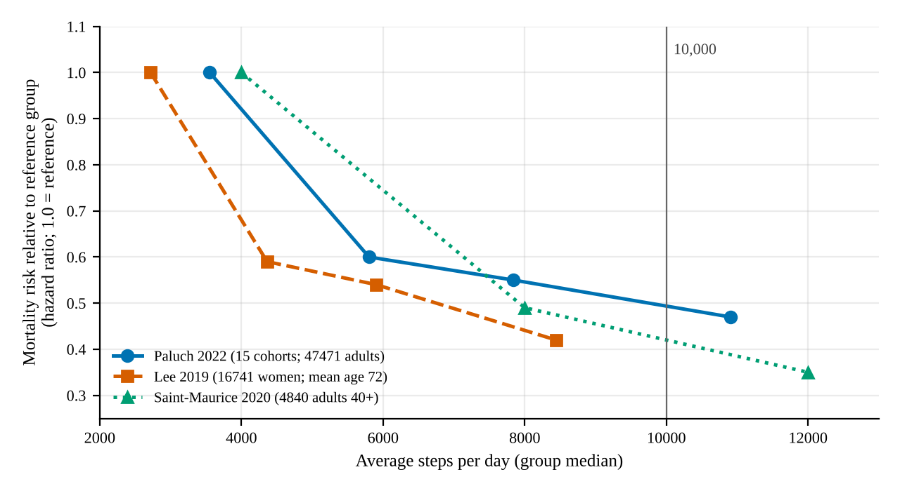

## Summary {#summary}

People who take more steps a day tend to live longer and to have lower rates of several diseases, in studies that follow thousands of adults for years. The link is steepest at the low end: going from about 2,000–4,000 steps a day to 6,000–8,000 goes with the biggest drop in risk. For most outcomes the curve then flattens somewhere between about 5,000 and 10,000 steps, depending on the outcome and the age group ([Q0](#q0), [Q2](#q2)). The 10,000 figure did not come from health research; it appears to derive from the name of a Japanese pedometer sold in 1965 ([Q1](#q1)). No study inspected shows a special threshold at 10,000. Benefits appear well below it, and for a few outcomes risk keeps falling beyond it. For adults under 60 the flattening point is estimated higher (about 8,000–10,000) than for adults over 60 (about 6,000–8,000), so 10,000 sits inside the younger range without being a necessary target ([Q5](#q5)).

How far to trust this: all the step studies are observational. People who walk less are often older, heavier or already unwell, and this shapes the results, so the size of the benefit is probably overstated, especially at the low end, even though the direction is consistent ([Q4](#q4)). Walking pace seems to matter less than total steps, but the evidence is mixed ([Q3](#q3)). A watch or phone count is not the same quantity as the hip-worn research devices behind most studies. Evidence specific to sedentary adults aged 25–60 is thinner than for older adults. These findings describe groups and associations, not a target for any individual.

<!-- RESEARCH_BODY_START -->

## Scope and how to read the evidence {#scope}

This review answers six questions: how daily steps relate to health outcomes in adults and whether 10,000 is a necessary or especially meaningful threshold (**Q0**, answered in the [conclusion](#q0)); where the figure came from (**Q1**, [here](#q1)); what the evidence shows for mortality, cardiovascular disease and other outcomes, including where benefits level off (**Q2**, [here](#q2)); whether pace matters beyond total steps (**Q3**, [here](#q3)); how strong the evidence is (**Q4**, [here](#q4)); and what it implies for mostly sedentary adults aged roughly 25 to 60 (**Q5**, [here](#q5)). People with diagnosed illness, athletes, people under 25, weight-loss programmes and individual medical advice are outside the scope.

Five terms recur. An **observational study** watches what people do and what happens to them, without assigning anyone to a behaviour as a trial does. A **cohort study** follows a group of people over time and records who later gets sick or dies. A **hazard ratio** (HR) compares the rate of an event between two groups: 0.60 means a 40% lower rate than the comparison group. **Confounding** means some other trait, such as age or smoking, explains part of an apparent link. **Reverse causation** means the outcome causes the exposure: people who are already ill walk less, which can make low step counts look like a cause of illness. A **dose-response** relationship describes how risk changes as the amount (here, steps) rises; a *plateau* is where it stops improving much.

## How the review was done {#method}

This is a structured narrative review, not a systematic one. On 9 November 2026 the web was searched by topic: the origin of the 10,000 figure, mortality meta-analyses, large cohorts, cardiovascular, cancer and dementia outcomes, pace, trials, device accuracy and sources of bias. Meta-analyses, large cohorts and trials were prioritised. The full text of three papers was opened ([[1]](#ref-1), [[2]](#ref-2), [[8]](#ref-8)). For the rest only abstracts or journal records were inspected, and for the 2025 meta-analysis [[5]](#ref-5) only the journal page excerpts and repository abstract, because the full text could not be retrieved. Each reference below states what was inspected. Searching stopped when new queries kept returning the same set of studies and the remaining gaps were about access, not about unexplored literature. Studies of office workers were not searched for specifically, and no source reporting a randomised trial of a step target against death or heart disease turned up; that is a limit of this search, not proof that none exists.

## Q1. Where did 10,000 steps come from? {#q1}

**F1.** The 10,000 figure most likely comes from a product name, not a health study. The 2019 study by Lee and colleagues says its origin is unclear but likely derives from the trade name of a pedometer sold in 1965 by the Yamasa Clock and Instrument Company in Japan, called Manpo-kei, which translates to "10,000 steps meter" ([[1]](#ref-1), Introduction). A 2004 review traces it to Japanese walking clubs and a business slogan more than 30 years earlier ([[10]](#ref-10), abstract). The 2022 pooled analysis agrees that it is not evidence-based and originates from a Japanese marketing campaign ([[2]](#ref-2), Introduction). A later review adds a rationale: the Japanese researcher Yoshiro Hatano studied typical steps per day across lifestyles and estimated that 10,000 steps corresponds to about 300 kilocalories of energy use a day ([[11]](#ref-11), excerpt).

That is a reasoning about energy expenditure, not a test of health outcomes: nothing inspected shows that anyone compared 10,000 with other step counts against disease or death at that time. Popular accounts add that the Japanese character for 10,000 resembles a walking figure; this explanation is widely repeated, but no original 1960s source for it could be inspected. Status: answered from scholarly secondary accounts; the 1960s advertising and Hatano's 1993 paper were not inspected.

## Q2. Steps, mortality and other outcomes {#q2}

**F2.** More daily steps go with lower all-cause mortality, steeply at first and then more gently. Table 1 lists the main sources; they differ in design and are not independent replications, because large pooled analyses draw on earlier cohorts.

**Table 1.** Main sources on steps and all-cause mortality. HR = hazard ratio (95% confidence interval).

| Source | Who and how | Main result |
|---|---|---|
| Lee 2019 [[1]](#ref-1) | 16,741 US women, mean age 72; hip device, 7 days; 4.3 years follow-up | About 4,400 vs 2,700 steps/day: HR 0.59 (0.47–0.75); levels off near 7,500 |
| Saint-Maurice 2020 [[3]](#ref-3) | 4,840 US adults aged 40+; follow-up to 2015 | 8,000 vs 4,000 steps: HR 0.49 (0.44–0.55); 12,000 vs 4,000: 0.35 (0.28–0.45) |
| Paluch 2022 [[2]](#ref-2) | 15 cohorts, 47,471 adults, 3,013 deaths; median follow-up 7.1 years | Quartile medians 5,801 / 7,842 / 10,901 vs 3,553: HR 0.60 / 0.55 / 0.47 |
| Banach 2023 [[4]](#ref-4) | 17 cohorts, 226,889 people, mean age 64 | Each extra 1,000 steps went with a 15% lower rate; benefit from roughly 4,000 steps upward |
| Ding 2025 [[5]](#ref-5) | 57 studies from 35 cohorts; 31 studies in meta-analyses | 7,000 vs 2,000 steps: HR 0.53 (0.46–0.60) |

Figure 1 plots three of these. Each series uses its own reference group, so the lines show shape, not one pooled curve.

**Figure 1.** All-cause mortality relative to each study's reference group (HR = 1.0) by average steps per day. Points are group medians from [[2]](#ref-2) and [[1]](#ref-1) (relative to the lowest quartile) and [[3]](#ref-3) (relative to 4,000 steps). Values from the papers' abstracts and Lee's Table 3, model 2; data in `assets/figure1-data.csv`. The studies differ in age, sex and adjustment. Not a pooled analysis.

**F3.** Where the curve levels off depends on age and outcome. In the 15-cohort analysis the flattening point was about 6,000–8,000 steps for people 60 and older and about 8,000–10,000 for those under 60 (age interaction p = 0.012) ([[2]](#ref-2), Results and Figure 3). The 2025 meta-analysis found inflection points around 5,000–7,000 steps for all-cause mortality, cardiovascular disease incidence, dementia and falls, but roughly straight-line declines with no plateau for cardiovascular mortality, cancer incidence and mortality, type 2 diabetes and depressive symptoms; it reported no age-specific analysis ([[5]](#ref-5), abstract). In UK Biobank (about 78,500 adults, mean age 61, wrist device), risks of death, cancer and cardiovascular disease fell with steps up to about 10,000 ([[6]](#ref-6)). For dementia in the same cohort, about half of the maximum benefit was already reached near 3,800 steps, and the lowest risk was near 9,800 ([[7]](#ref-7)).

**F4.** The 2025 authors conclude that 10,000 steps remains a viable target for people who are more active, but that about 7,000 is associated with clinically meaningful improvement and may be more achievable ([[5]](#ref-5), Interpretation). Certainty (a formal rating of how far evidence can be trusted) was moderate for most outcomes, but low for cardiovascular mortality, cancer incidence and physical function, and very low for falls ([[15]](#ref-15)). So the shape depends on the outcome, and nothing in these results singles out 10,000 as a break point. Banach's analysis and the Paluch pooled analysis may share cohorts, so their agreement is not two independent confirmations.

A rough cross-check from a different measure: the standard guideline of 150 minutes a week of moderate activity maps to roughly 7,000–8,000 steps a day when everyday walking is counted ([[12]](#ref-12), abstract), and Lee's own arithmetic gives about 6,900 ([[1]](#ref-1), Discussion). This is consistent with the observed range, but it is not independent evidence about health.

## Q3. Does pace matter beyond total steps? {#q3}

**F5.** Total steps carry most of the association; the added value of pace is unresolved. Pace here means cadence, steps per minute; about 100 steps a minute marks moderate walking (roughly 2.5 mph) ([[1]](#ref-1), Table 1). In older women, faster stepping was linked to lower mortality, but after adjusting for total steps the links were mostly no longer significant (for example peak 30-minute cadence HR 0.86, 0.65–1.13) ([[1]](#ref-1), Table 4). The US adult study found the same (HR 0.90, 0.65–1.27) ([[3]](#ref-3)). The pooled analysis found a split: best-effort cadence over 30 or 60 minutes stayed linked to lower mortality after adjustment (HR 0.67 for each), but minutes spent at 40 or 100 steps a minute did not, and the authors called the overall result inconclusive ([[2]](#ref-2), Results and Discussion). UK Biobank found that faster stepping added benefit, especially for disease incidence ([[6]](#ref-6)). The mixed picture may reflect that fast walkers also take more steps and are fitter, which is hard to separate. Most people spent very little time at 100 steps a minute or more (median 5.2 minutes a day) ([[2]](#ref-2)), so the data are thin where pace matters most.

## Q4. How strong is the evidence? {#q4}

**F6.** The step-and-outcome evidence is observational, so it shows association, not proof that walking more causes the benefit. Confounding is visible in the data. In the largest women's cohort, the lowest-step quartile versus the highest was older (75.2 vs 69.7 years), had more diabetes (16.7% vs 4.2%) and high blood pressure (83.8% vs 54.3%), and more smoking (5.6% vs 1.8%) ([[1]](#ref-1), Table 2). Statistical adjustment reduces but cannot remove such differences; adjusting for such factors raised the top-quartile hazard ratio from 0.33 to 0.42, and the authors note that findings may reflect prior habitual stepping and healthy state ([[1]](#ref-1), Table 3 and Limitations).

Reverse causation is the second concern. In the pooled analysis, the association was much stronger in studies with under six years of follow-up (HR 0.32, 0.25–0.41, top versus bottom quartile) than in studies with six years or more (0.57, 0.49–0.66), which fits some low step counts being a symptom of illness near the start. Excluding deaths in the first two years attenuated the result but it remained significant ([[2]](#ref-2), Results). Lee's analysis excluding the first year and women with heart disease, cancer or diabetes still gave an HR of 0.50 for the top quartile ([[1]](#ref-1), Results). Together, a real benefit probably exists, and the sizes in Table 1 are likely too large.

**F7.** Trials show short-term effects on risk markers, not on death. A review of pedometer studies (8 randomised trials among 26 studies, mean 18 weeks) found users walked roughly 2,000–2,500 more steps a day and lowered systolic blood pressure by 3.8 mmHg (1.7–5.9) ([[9]](#ref-9)). A later review of 14 trials found a similar 3.1 mmHg fall and concluded there was no evidence that 10,000 steps specifically lowers blood pressure markedly ([[13]](#ref-13)). No trial testing step targets against death or heart attacks turned up in this search, so the claim "walking more *causes* longer life" rests on observational data plus the wider, well-established physical activity literature.

**F8.** Step counts differ by device, and the research counts are mostly from hip-worn devices. A review of 158 studies of consumer wearables found that in laboratory tests devices tended to undercount steps (median error −2%, mean −9%), with 45.2% of comparisons within ±3%; in everyday life, measured against a research accelerometer, they tended to overcount slightly (mean +5%) and only 42% were within ±10% ([[8]](#ref-8), Results). The studies were mostly small, mean participant age 36.8, and the devices are now old. The pooled analysis notes that counts from research and consumer devices can differ by 20% or more, and that most studies used hip devices while many consumer devices sit on the wrist ([[2]](#ref-2), Discussion). In one video-referenced comparison cited by Lee, a hip-worn research device recorded about 7,400 steps a day against about 8,100–8,200 on two Fitbit models, and all undercounted ([[1]](#ref-1), Discussion). Most of the 2025 evidence came from waist or hip devices, 70% of studies ([[14]](#ref-14)). So the 10,000 on a watch is not exactly the 10,000 in a study. Counts correlated highly across devices in one comparison ([[1]](#ref-1)), so rankings of people are probably similar, but absolute thresholds are fuzzy.

## Q5. What does this imply for sedentary adults aged 25 to 60? {#q5}

**F9.** The evidence for this group is thinner, and the implications are conditional. Most cohorts were older: from the 15-cohort table, only about five (count from the table) had a mean age under 60 ([[2]](#ref-2), Table 1). The 2025 meta-analysis did no age-specific analysis ([[5]](#ref-5)). No inspected study targeted office workers. Within those limits:

- **Starting point.** Under about 5,000 steps a day is conventionally called a sedentary lifestyle ([[10]](#ref-10)). The steepest relative gains in every dataset are at this low end, for example from about 2,700 to 4,400 steps (HR 0.59) ([[1]](#ref-1)).
- **Younger adults.** The estimated flattening point for people under 60 is about 8,000–10,000 steps, so 10,000 is near the top of the plateau, not a threshold that must be reached; no source inspected shows harm from more steps ([[2]](#ref-2), Discussion).
- **Effort in practice.** At roughly 100 steps a minute, 10 minutes of brisk walking is about 1,000 steps ([[12]](#ref-12), abstract). The increases seen in pedometer programmes, about 2,000–2,500 steps ([[12]](#ref-12)), correspond to roughly 20–25 minutes at that pace, or more at a slower pace (arithmetic from the cited figures).
- **Absolute versus relative risk.** Hazard ratios describe relative change. In Lee's older women, the gap between top and bottom quartiles was 9.3 deaths per 1,000 person-years ([[1]](#ref-1), Results). Adults aged 25–60 have much lower baseline death rates, so the same relative reduction means a far smaller absolute difference. Hypothetically, if baseline were 1.5 deaths per 1,000 person-years, an HR of 0.60 would mean about 0.6 fewer per 1,000 person-years. This baseline is illustrative, not from a source.

Benefits for this group may be broader than mortality: cancer, cardiovascular disease and depressive symptoms also fell with more steps in the 2025 and UK Biobank analyses ([[5]](#ref-5), [[6]](#ref-6)), though those cohorts were older and the evidence for some outcomes was rated low certainty.

## Limitations {#limitations}

This is a narrative review, not an exhaustive one. Several sources (Saint-Maurice, Banach, Ding, the UK Biobank papers, Bravata) were read at abstract or record level, so details such as subgroup numbers were not independently checked in full text. Banach's age-specific results and the grading of certainty for the 2025 outcomes were not read in the originals and are omitted or attributed to secondary summaries. No original 1960s source on the figure's origin was inspected. Outcome coverage beyond mortality rests mainly on one 2025 meta-analysis whose limits include few studies per outcome and residual confounding ([[5]](#ref-5)). Nearly all cohorts were from high-income countries and mainly White volunteers ([[2]](#ref-2), Discussion). Each study measured steps over about a week at one time, and activity changes.

## Likely audience questions {#faq}

**"Is 10,000 steps a myth?"** The number was not derived from health research (F1), and research shows benefits well below it (F2–F3). It is also not shown to be harmful; for younger adults it lies inside the range where benefit flattens (F3, F9).

**"I only get about 3,000. Is it worth trying to do more?"** The studies show the biggest relative differences between very low and moderate step counts (F2). Given confounding, the size is probably overstated (F6), but the direction is consistent.

**"Do I have to walk fast?"** Total steps matter most; whether pace adds more is unresolved (F5). The evidence does not say fast walking is unhelpful.

**"Can my watch be trusted?"** Roughly for comparing yourself over time, less for matching a study's thresholds (F8).

**"Do more than 10,000 steps hurt?"** The pooled analysis did not find higher mortality at high step volumes ([[2]](#ref-2), Discussion), and some outcomes kept improving (F3). Data at very high counts are sparse.

**"Is it the walking, or just that healthy people walk more?"** Partly the latter; some of the association is surely confounding and reverse causation, but the benefit persisted after attempts to remove these (F6).

## Conclusion and answer to the primary question (Q0) {#q0}

**Q0.** Higher daily step counts are consistently associated with lower mortality and lower risk of several diseases in adults. The association is steepest between very low and moderate counts, and for most outcomes it flattens somewhere between about 5,000 and 10,000 steps, later for younger adults (F2–F4). The evidence does not support 10,000 as a necessary or special threshold: the figure traces to a 1965 pedometer name (F1), benefits appear well below it, and no source inspected shows a break at that value (F4). Neither is 10,000 shown to be unhelpful; it is within the plateau range for adults under 60 and some outcomes keep improving (F3). Confidence: moderate that more steps go with lower risk; low to moderate for the size of the benefit, which is probably inflated by confounding and reverse causation (F6); low for sedentary adults aged 25–60 specifically (F9).

<!-- RESEARCH_BODY_END -->

## References {#references}

### [1] Lee, I-M., Shiroma, E. J., Kamada, M., Bassett, D. R., Matthews, C. E., & Buring, J. E. (2019). Association of step volume and intensity with all-cause mortality in older women. *JAMA Internal Medicine*, 179(8), 1105–1112. {#ref-1}
Peer-reviewed cohort study. DOI: [10.1001/jamainternmed.2019.0899](https://doi.org/10.1001/jamainternmed.2019.0899). Full text inspected (author-posted PDF copy).

### [2] Paluch, A. E., Bajpai, S., Bassett, D. R., et al. (2022). Daily steps and all-cause mortality: a meta-analysis of 15 international cohorts. *The Lancet Public Health*, 7(3), e219–e228. {#ref-2}
Peer-reviewed meta-analysis. DOI: [10.1016/S2468-2667(21)00302-9](https://doi.org/10.1016/S2468-2667(21)00302-9). Full text inspected (PubMed Central author manuscript, PMC9289978); appendix not inspected.

### [3] Saint-Maurice, P. F., Troiano, R. P., Bassett, D. R., et al. (2020). Association of daily step count and step intensity with mortality among US adults. *JAMA*, 323(12), 1151–1160. {#ref-3}
Peer-reviewed cohort study. DOI: [10.1001/jama.2020.1382](https://doi.org/10.1001/jama.2020.1382). Abstract (MEDLINE record) inspected; full text not opened.

### [4] Banach, M., Lewek, J., Surma, S., et al. (2023). The association between daily step count and all-cause and cardiovascular mortality: a meta-analysis. *European Journal of Preventive Cardiology*, 30(18), 1975–1985. {#ref-4}
Peer-reviewed meta-analysis. DOI: [10.1093/eurjpc/zwad229](https://doi.org/10.1093/eurjpc/zwad229). Abstract and repository record inspected; full text not opened. Sources give the reference-quartile median as 3,867 or 3,967 steps, so only "roughly 4,000" is used here.

### [5] Ding, D., Nguyen, B., Nau, T., et al. (2025). Daily steps and health outcomes in adults: a systematic review and dose-response meta-analysis. *The Lancet Public Health*. {#ref-5}
Peer-reviewed systematic review and meta-analysis. DOI: [10.1016/S2468-2667(25)00164-1](https://doi.org/10.1016/S2468-2667(25)00164-1). Abstract and journal-page excerpts inspected; the journal full text could not be retrieved, so tables, figures and the 10,000-versus-7,000 comparisons were not checked.

### [6] del Pozo Cruz, B., Ahmadi, M. N., Lee, I-M., & Stamatakis, E. (2022). Prospective associations of daily step counts and intensity with cancer and cardiovascular disease incidence and mortality and all-cause mortality. *JAMA Internal Medicine*. {#ref-6}
Peer-reviewed cohort study (UK Biobank). DOI: [10.1001/jamainternmed.2022.4000](https://doi.org/10.1001/jamainternmed.2022.4000). Abstract and key-points excerpts inspected; full text blocked.

### [7] del Pozo Cruz, B., Ahmadi, M., Naismith, S. L., & Stamatakis, E. (2022). Association of daily step count and intensity with incident dementia in 78,430 adults living in the UK. *JAMA Neurology*, 79(10), 1059–1063. {#ref-7}
Peer-reviewed cohort study (UK Biobank). DOI: [10.1001/jamaneurol.2022.2672](https://doi.org/10.1001/jamaneurol.2022.2672). Key points and abstract inspected (PubMed Central, PMC9449869).

### [8] Fuller, D., Colwell, E., Low, J., et al. (2020). Reliability and validity of commercially available wearable devices for measuring steps, energy expenditure, and heart rate: systematic review. *JMIR mHealth and uHealth*, 8(9), e18694. {#ref-8}
Peer-reviewed systematic review. DOI: [10.2196/18694](https://doi.org/10.2196/18694). Full text inspected (PMC7509623; first part of the page read, appendices not).

### [9] Bravata, D. M., Smith-Spangler, C., Sundaram, V., et al. (2007). Using pedometers to increase physical activity and improve health: a systematic review. *JAMA*, 298(19), 2296–2304. {#ref-9}
Peer-reviewed systematic review. DOI: [10.1001/jama.298.19.2296](https://doi.org/10.1001/jama.298.19.2296). Abstract and excerpts inspected; the 2,000-step figure is from a trial-level summary excerpt.

### [10] Tudor-Locke, C., & Bassett, D. R. (2004). How many steps/day are enough? Preliminary pedometer indices for public health. *Sports Medicine*, 34(1), 1–8. {#ref-10}
Peer-reviewed review. DOI: [10.2165/00007256-200434010-00001](https://doi.org/10.2165/00007256-200434010-00001). Abstract (PubMed) inspected.

### [11] Tudor-Locke, C., Hatano, Y., Pangrazi, R. P., & Kang, M. (2008). Revisiting "How many steps are enough?" *Medicine & Science in Sports & Exercise*, 40(7 Suppl), S537–S543. {#ref-11}
Peer-reviewed review. DOI: [10.1249/MSS.0b013e31817c7133](https://doi.org/10.1249/MSS.0b013e31817c7133). Opening excerpt inspected in a third-party PDF copy.

### [12] Tudor-Locke, C., Craig, C. L., Brown, W. J., et al. (2011). How many steps/day are enough? For adults. *International Journal of Behavioral Nutrition and Physical Activity*, 8, 79. {#ref-12}
Peer-reviewed review. DOI: [10.1186/1479-5868-8-79](https://doi.org/10.1186/1479-5868-8-79). Abstract inspected.

### [13] Journal of Human Hypertension (2018). The required step count for a reduction in blood pressure: a systematic review and meta-analysis. 32(12), 814–824. {#ref-13}
Peer-reviewed systematic review and meta-analysis (authors not shown in the inspected record). DOI: [10.1038/s41371-018-0100-z](https://doi.org/10.1038/s41371-018-0100-z). Abstract inspected.

### [14] The Lancet Public Health (2025). Reflections on daily steps and health outcomes (correspondence on Ding et al.). {#ref-14}
Journal correspondence. Journal-page excerpt inspected; used only for the share of waist/hip devices (40 of 57 studies).

### [15] HealthDay News (2025, July 29). 7000 steps per day tied to clinically meaningful benefits in health outcomes. {#ref-15}
News summary of [5], secondary source. Used only for the certainty ratings by outcome, which were not checked against the paper.

Research ID: daily-step-counts-health-2026-11 · Report 1.0 · Scope: daily-step-counts-health.rb.md · Protocol 1.7b.10
