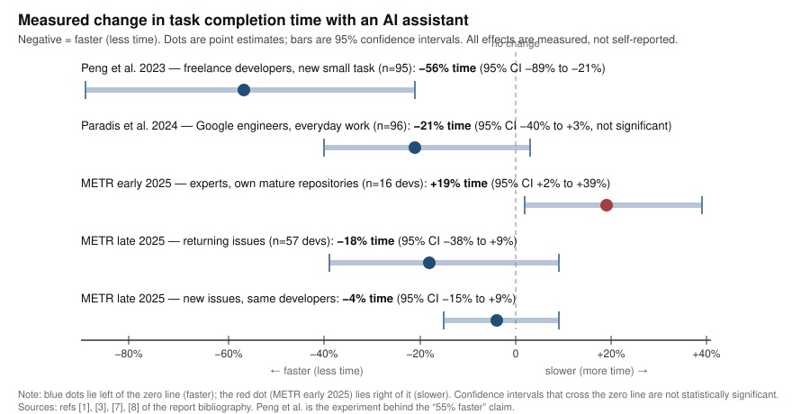

# Do AI coding assistants speed up experienced developers? What controlled evidence measures, and where "55% faster" comes from

*Subtitle: A structured narrative review of randomized and large-sample studies, 2022–2026*

Language: English · Finalized: 2026-11-09

## Summary

The widely quoted "55% faster" figure is real but narrow: it comes from one controlled experiment in which freelance developers, average about six years of experience, implemented a small HTTP server from scratch, and the group with GitHub Copilot finished in 71 minutes versus 161 minutes without it (a 55.8% reduction, 95% CI 21–89%). Code quality was not measured, and the study's own analysis found the largest gains for *less* experienced developers. Across the broader evidence, measured effects vary systematically: enterprise field experiments at Microsoft, Accenture, and a Fortune 100 firm find about 26% more completed tasks per week among adopters (junior-skewed; not time per task), a Google trial on a complex enterprise task found about 21% faster completion (a wide confidence interval that includes no effect), and the only randomized trial of experienced experts working in their own large, mature open-source repositories found they were 19% *slower* with early-2025 AI tools. Newer (late-2025) tools show point estimates in the positive direction in a follow-up study, but selection effects make that evidence weak. Perceived speed systematically exceeds measured speed — in the expert trial, developers believed AI made them 20% faster while it made them 19% slower. The 55% claim is not supported as a general statement about experienced developers on large existing codebases; measured, quality-adjusted net gains at that scale have not been demonstrated.

<!-- RESEARCH_BODY_START -->

## Scope, questions, and concepts

This review examines AI coding assistants of the large-language-model era (roughly 2022 onward), such as GitHub Copilot, Cursor, and comparable tools: systems that suggest or generate code inline, in chat, or through agents. The primary population is experienced professional software developers; results from students and novices appear only as contrast. The priority setting is large or existing codebases; new, small, or greenfield projects appear as contrast. Outcomes are *measured* productivity: task completion time, throughput from instrumented telemetry, and quality-adjusted net outcomes such as defects, rework, and maintenance cost. Self-reported productivity is examined as a separate phenomenon, not accepted as a productivity measurement. Tool-versus-tool recommendations, job-market effects, and general AI writing assistance are out of scope.

The review answers one primary and three secondary questions:

- **Q0 {#q0-questions}.** Do AI coding assistants measurably increase the productivity of experienced developers, and does the evidence support the widely quoted "55% faster" claim?
- **Q1 {#q1-questions}.** What is the provenance of the "55% faster" figure — which study, what population, what task, what measurement?
- **Q2 {#q2-questions}.** How do measured effects vary by developer experience and by codebase size and maturity?
- **Q3 {#q3-questions}.** What explains gaps between perceived and measured productivity (self-report versus instrumentation, review and rework costs, defect rates)?

Three concepts recur. A *randomized controlled trial (RCT)* assigns the intervention (AI access) by chance, so differences in outcome are causally attributable to the intervention rather than to who chose to use the tool; it is the strongest single-study design but answers only for the population and task studied. An *effect size* here is a percentage change in some measured outcome (time, task counts); a *95% confidence interval (CI)* is the range within which the true effect plausibly lies given the sample — a wide interval means the study pinpoints the direction only loosely, and an interval crossing zero means "no effect" has not been ruled out. Finally, *throughput* (counts of pull requests, commits, or builds) and *speed* (time per task) are different outcomes: producing 26% more pull requests per week is not the same as finishing each task 26% faster, because output counts can rise through smaller tasks, more code per change, or more attempts, without more value delivered. No study below measures all of these at once, which is why their results are reported side by side, not pooled.

## How this review was done

This is a structured narrative evidence review, not a systematic review: studies were identified, appraised, and synthesized without claiming exhaustive coverage. Searches (2026-11-09) targeted the provenance of the 55% figure, randomized and controlled trials with measured outcomes, large-sample telemetry studies, negative results, and criticism or follow-ups of each key study; press coverage was used only to locate primary sources. Primary sources (preprints, an author-hosted working-paper PDF, a peer-reviewed conference paper, vendor research reports, and announcement posts carrying survey findings) were opened and read; remembered knowledge was not treated as inspected evidence. The most decision-relevant studies are controlled trials with measured outcomes: one small controlled experiment [[1]](#ref-1), three enterprise field experiments analyzed together [[2]](#ref-2), one enterprise RCT [[3]](#ref-3), and two randomized trials on experienced open-source developers [[4]](#ref-4)[[5]](#ref-5), complemented by a large survey-plus-telemetry case study [[6]](#ref-6)[[7]](#ref-7), a security user study [[8]](#ref-8), industry code-change telemetry [[9]](#ref-9), and two annual DevOps survey programs [[10]](#ref-10)[[11]](#ref-11). Searching stopped when repeated query families returned only studies already assessed or clearly irrelevant; that is a stopping judgement, not proof of coverage. Access limits are listed under Limitations.

## Q1: Where the "55% faster" figure comes from {#q1}

The figure traces to a controlled experiment run by GitHub and Microsoft researchers from May 15 to June 20, 2022, published as a preprint in February 2023 (Peng, Kalliamvakou, Cihon, and Demirer) [[1]](#ref-1). Its path into general circulation ran through GitHub's own blog, which reported in 2022 that "developers who used GitHub Copilot completed the task significantly faster–55% faster than the developers who didn't use GitHub Copilot," and through enterprise marketing that repeated "helps developers code up to 55% faster" [[12]](#ref-12)[[13]](#ref-13).

What the experiment actually measured, in its own terms:

- **Population.** 95 developers recruited through the freelancing platform Upwork, randomly split into 45 treated and 50 control; 35 completed the task and survey. Most were aged 25–34, located in India and Pakistan, with median yearly income of $10,000–$19,999 and an average of six years of coding experience; about 45% were self-employed (Study Design; Figure 5; as summarized in [[3]](#ref-3)).
- **Task.** Implement an HTTP server in JavaScript "as quickly as possible," starting from a skeleton repository, with correctness defined as passing 12 automated tests. Completion time ran from repository creation to the first commit passing all tests. This is a small, self-contained, greenfield task — not work on a large existing codebase.
- **Result.** Treated developers completed the task in 71.17 minutes on average versus 160.89 minutes for controls: a 55.8% reduction in completion time, p = 0.0017, 95% CI 21%–89% (Results, Figure 6). Four slow outliers, all in the control group, inflate the raw gap; the authors report the result is robust to dropping them.
- **Success and quality.** The treated group passed the tests at a 7 percentage point higher rate (78% vs 70% in GitHub's summary), not statistically significant (95% CI −0.11 to 0.25) [[1]](#ref-1)[[12]](#ref-12). Code quality, security, and maintainability were not assessed — the authors state this explicitly as a limitation (Discussion).
- **Who gained most.** Developers with *less* professional experience, those coding more hours per day, and older developers benefited most (Table 1, heterogeneous effects).

**Appraisal.** As a small randomized experiment on one task, the study is internally credible: randomization was real, time was measured by repository telemetry rather than self-report, and the confidence interval excludes zero. But the number "55%" is a task-level speed effect for a mixed freelance population on a self-contained exercise, with a wide confidence interval (21–89%) and no quality measurement. The authors themselves flag that it does not examine collaboration on large projects and does not examine code quality (Discussion). It is the apparent leading source of the manager-style claim, but it does not establish that experienced developers on existing codebases get 55% faster. **Q1 is answered**: the figure exists, is honestly computed, and is narrow in what it measures.

## Q0 and Q2: What controlled studies measure, and how effects vary {#q0}

Every study below measured something different; the pattern across them is the finding. Measured effects shrink as three things increase: the developer's experience and familiarity with the code, the size and maturity of the codebase, and the realism of the quality bar. The studies are summarized in Table 1; Figure 1 compares the four studies that measured *time per task* on a common axis.

*Figure 1. Measured change in task completion time with AI assistance. Negative (left) = faster; the dashed line is no effect. Points are the studies' main estimates (regression-adjusted where provided); bars are 95% confidence intervals. Populations, tasks, tools, and tool generations differ, so these are not replications of one another and are not pooled. Sources: Peng et al. 2023 (Figure 6); Paradis et al. 2024 (Section VI-B, Model 2); METR 2025 (Becker et al., core result); METR 2026 update (returning and newly recruited developer estimates).*

Table 1. Key studies and what each measured.

| Study | Design | Population | Setting | Measured outcome | Main result (95% CI) |
|---|---|---|---|---|---|
| Peng et al. 2023 [[1]](#ref-1) | Controlled experiment (randomized) | 95 Upwork freelancers, avg 6 yrs experience; 35 completed | Small greenfield task (HTTP server in JS) | Task completion time | 55.8% faster (21–89%); success +7pp, NS |
| Cui et al. 2025 [[2]](#ref-2) | 3 enterprise field experiments (randomized access) | 4,867 developers at Microsoft, Accenture, Fortune 100 firm | Ordinary daily work | Weekly completed tasks (PRs); commits; builds | PRs +26.08% (SE 10.3%); commits +13.55%; builds +38.38% |
| Paradis et al. 2024 [[3]](#ref-3) | RCT | 96 full-time Google engineers | Complex enterprise task, unfamiliar existing code | Time on task | Raw: 96 vs 114 min (p=.038); adjusted: ~21% faster (CI −40% to +3%, p=.086) |
| METR 2025 [[4]](#ref-4) | RCT (issue-level) | 16 experienced open-source maintainers, mature repos (avg 1M+ lines) | Own repositories, real issues | Implementation time | 19% slower (CI: 2–39% slower) |
| METR 2026 update [[5]](#ref-5) | RCT (issue-level), selection-limited | 57 open-source developers, more diverse repos | Own repositories, late-2025 tools | Implementation time | Returning: ~18% faster (38% faster to 9% slower); new: ~4% faster (15% faster to 9% slower) |
| Ziegler et al. 2022/2024 [[6]](#ref-6)[[7]](#ref-7) | Survey + IDE telemetry (no experiment) | 2,047 Copilot users (technical preview) | Everyday use | Perceived productivity vs usage metrics | Best predictor (acceptance rate) correlates ρ=0.24 |
| DORA 2024/2025 [[10]](#ref-10)[[11]](#ref-11) | Annual surveys (correlational) | ~39,000 (2024); ~5,000 (2025) technology professionals | Organizational | Self-reported adoption vs delivery metrics | 2024: 25% higher AI adoption ↔ −1.5% throughput, −7.2% stability; 2025: throughput relation positive, stability still negative |

**Where gains are large.** The 55.8% result is the top of the measured range, and it came from a greenfield task solved from scratch — precisely the setting where code generation replaces the slowest part of the work (writing from nothing) and there is no existing system to understand [[1]](#ref-1). In ordinary enterprise work, the pooled analysis of three randomized field experiments at Microsoft, Accenture, and a Fortune 100 electronics manufacturer (4,867 developers) estimated that *using* GitHub Copilot raised weekly completed pull requests by 26.08% (SE 10.3%) for adopters, with commits up 13.55% and builds up 38.38% [[2]](#ref-2) (Results). These are real, randomized-access designs, but the outcome is a count, not a time saving: more pull requests per week can reflect faster work, more but smaller tasks, or more verbose code — the authors themselves note that a less optimistic reading of the build-count increase is possible, and the companion analysis finds *no* improvement in build success rate, which was slightly negative at Accenture [[2]](#ref-2).

**Experience modifies the effect — in the same direction in every study that measured it.** At Microsoft, short-tenure developers increased output by 27–39% while long-tenure developers gained 8–13% (not always statistically significant); junior employees showed the same pattern, and short-tenure developers were also 9.4 percentage points more likely to adopt (81.6% vs 72.1%) [[2]](#ref-2) (Section on heterogeneity). In the original 55% experiment, less experienced developers benefited most [[1]](#ref-1). In Google's RCT, seniority and daily coding hours predicted speed regardless of AI, and the AI advantage was statistically fragile once those factors were controlled: raw means were 96 minutes with AI versus 114 without (t-test p = .038), but the adjusted estimate was 21% faster with a 95% CI spanning 40% faster to 3% *slower* (p = .086) [[3]](#ref-3) (Section VI). The Google task is instructive for this review's readers: experienced engineers, an unfamiliar but well-tooled enterprise codebase, a realistic definition of done (build and test) — and a modest, imprecise gain.

**Where the measured effect turned negative.** The randomized trial most relevant to experienced developers on large existing codebases — METR's 2025 study of 16 open-source experts (median about ten years of experience) maintaining their own repositories, averaging over 1 million lines of code, on 246 real issues (~2 hours each) — found AI-allowed issues took 19% longer (95% CI: 2–39% slower), using primarily Cursor with Claude 3.5/3.7 Sonnet, the frontier coding tools of early 2025 [[4]](#ref-4). The slowdown was not an artifact of low-quality submissions: developers' pull requests in both conditions met their normal standards (style, tests, documentation), and the result survived robustness checks the authors ran against differential task dropping, non-compliance, and alternative estimators [[4]](#ref-4). The paper's factor analysis attributes the result to five things: developers overestimated AI's usefulness; the developers were unusually fast because they knew their repositories; the repositories were large and complex; AI output was unreliable (developers accepted under 44% of generations and made major clean-up edits); and the repositories carried implicit context and tacit knowledge the tools could not access [[4]](#ref-4) (Appendix C.1). In other words, the same expertise and codebase maturity that define this review's reader population are the factors the study identifies as eliminating the AI advantage for that cohort.

**The tool generation matters, and the newest evidence is genuinely weaker.** METR's follow-up (from August 2025, 57 developers, 143 repositories, 800+ tasks, using late-2025 agentic tools) found point estimates in the opposite direction: about 18% *faster* for the ten returning developers (95% CI from 38% faster to 9% slower) and about 4% faster for newly recruited developers on more diverse, smaller, less mature repositories (95% CI from 15% faster to 9% slower) [[5]](#ref-5). However, METR itself judges this dataset an unreliable signal: 30–50% of participating developers admitted withholding tasks they did not want to do without AI, recruitment increasingly missed developers unwilling to work without AI, and time reporting broke down when developers ran multiple agents concurrently [[5]](#ref-5). METR's own reading is that developers were probably more helped by early-2026 tools than by early-2025 tools, but that the data provide only weak evidence about the size — and the earlier 19% slowdown result "no longer reflects the current impact" without being replaced by a comparably clean estimate [[5]](#ref-5).

**Answering Q0.** The measured evidence does not support "AI assistants make developers 55% faster" as a general claim, and it does not support it specifically for experienced developers on large existing codebases. What the evidence supports is: large speedups (up to ~55%) on small, self-contained, greenfield tasks; a moderate, imprecisely estimated speedup (~21%, CI −40% to +3%) for experienced engineers on a complex enterprise task in an unfamiliar but well-supported codebase; a moderate throughput gain (~26% more completed tasks) in enterprise settings that is concentrated among less experienced and shorter-tenure developers and is not quality-adjusted; and a 19% slowdown for experts in their own large, mature repositories with early-2025 tools. No study demonstrates a quality-adjusted *net* productivity gain of anything close to 55% for any population; the studies that measure time do not measure quality, and the studies that measure output counts do not measure time or value per unit. **Confidence: moderate** — the pattern is consistent across independent teams and designs, but each cell of the experience-by-setting grid contains at most one randomized study, and the tool landscape is changing faster than the literature.

**Answering Q2.** Measured gains decrease with developer experience, familiarity with the code, and codebase maturity. Novice-adjacent populations and greenfield tasks sit at the top of the range (55.8% time; +27–39% output for short-tenure developers); experienced developers on unfamiliar-but-well-tooled enterprise code sit in the middle (~21%, statistically fragile); experts on large, mature, familiar codebases sat at the bottom — negative with early-2025 tools — and the late-2025 measurements on similar but more diverse repositories returned to small positive point estimates that selection effects prevent reading precisely [[1]](#ref-1)[[2]](#ref-2)[[3]](#ref-3)[[4]](#ref-4)[[5]](#ref-5). **Confidence: moderate**, with the experience gradient better supported (consistent in four studies) than the codebase-maturity gradient (one direct study plus indirect signals).

## Q3: Why perceived speed exceeds measured productivity {#q3}

The most direct evidence is a roughly 40-percentage-point perception gap inside a randomized trial: before the METR study, its expert developers forecast AI would make them 24% faster; after finishing the work, they believed it had made them 20% faster; the instruments showed they were 19% slower [[4]](#ref-4). This gap is not a peculiarity of one survey question. A large case study pairing survey responses with IDE telemetry (2,047 Copilot users matched to usage data, by the tool's own developers) found that the *best* behavioral predictor of perceived productivity — the rate at which shown suggestions are accepted — correlated only ρ = 0.24 with self-reported productivity, leaving, in the authors' words, "considerable unexplained variance," and they caution explicitly that "user-perceived productivity is also not necessarily actual productivity" [[6]](#ref-6). The same study reports that junior developers both report larger gains and accept more suggestions [[7]](#ref-7). Earlier user-study evidence points the same way: a controlled comparison of Copilot against IntelliCode found no significant correlation between task completion times and participants' survey responses [[6]](#ref-6), and the original usability study of Copilot found no significant improvement in completion time or success rate while most participants still preferred it — the classic preference-versus-performance split [[14]](#ref-14).

Several mechanisms explain the gap:

1. **Self-reports measure a counterfactual the respondent cannot observe.** "How much faster did AI make you?" asks a developer to re-run an unrunnable experiment. The systematic error is upward: in METR's data the error was about 20 points against a measured −19% [[4]](#ref-4); in a security user study, 47 participants with an AI assistant wrote significantly less secure code than the control group *and were more likely to believe they had written secure code* [[8]](#ref-8) — overconfidence about output quality, not just speed.
2. **Output counts inflate while value does not.** Weekly pull requests, commits, and builds all rose in the enterprise field experiments (+26.08%, +13.55%, +38.38%) without any measured improvement in build success [[2]](#ref-2). METR's authors make the same point about benchmarks and telemetry generally: code can be more verbose but functionally equivalent, and work can be split into more, smaller tasks, raising counts while total work is unchanged [[4]](#ref-4).
3. **Costs move downstream, outside the measurement window.** Industry-scale code-change telemetry (211 million changed lines, 2020–2024, commercial and large open-source repositories) found trends consistent with displaced cost: "moved" (refactored) lines fell from 24.8% of changed lines in 2021 to 9.5% in 2024; within-commit copy/paste rose from 8.4% to 12.3% and, for the first time on record, exceeded moved lines; commits containing blocks of five or more duplicated lines increased roughly eight-fold during 2024; and churn (lines reverted or re-edited within two weeks) rose from about 3.3% of changes in 2021 to 5.7% in 2024 [[9]](#ref-9). These are correlational time trends from vendor research, not causal estimates — AI adoption is the obvious but unproven driver — but duplicated and churned code are exactly the currencies in which a speedup today is repaid as review time, bug fixes, and maintenance later.
4. **Organizational telemetry shows the same asymmetry.** The 2024 DORA survey program (≈39,000 professionals) estimated that a 25% increase in AI adoption was accompanied by a 1.5% *decrease* in delivery throughput and a 7.2% *decrease* in delivery stability, even while self-reported individual benefits (documentation quality, code quality, review speed) were positive [[10]](#ref-10). The 2025 DORA survey (~5,000 professionals, 90% AI adoption, over 80% believing AI increased their productivity) reversed the throughput relationship to positive but still found a negative relationship with delivery stability, describing AI as an accelerator that "can expose weaknesses downstream" without robust control systems [[11]](#ref-11). These are survey-based correlations, not experiments, and the two years' throughput signs disagree — treat them as context, not proof.

**Answering Q3.** The perception gap is well documented and multiply caused: developers cannot observe the counterfactual and systematically overestimate AI's contribution; instruments that count output record inflation, not value; and quality, review, and maintenance costs land downstream of the tasks being timed, in currencies (churn, duplication, instability, build failures) that no experimental study yet links end-to-end. Where studies do measure the same developer's belief and behavior at once, belief exceeds measurement by about 20–40 percentage points [[4]](#ref-4)[[6]](#ref-6)[[8]](#ref-8). **Confidence: moderate-high** on the existence of the gap (direct randomized measurement plus converging independent evidence), **low-to-moderate** on the size of the downstream quality cost (correlational evidence only).

## What this means for experienced developers on large existing codebases

Read as a decision aid, the evidence is conditional, not for-or-against:

- **The 55% figure should not be used for planning.** It describes one small greenfield task with a freelance population and no quality measurement, with a confidence interval of 21–89% [[1]](#ref-1). Quoting it as an expected team-level speedup for senior engineers on a mature codebase attributes to it a population and setting it explicitly did not test (its own authors say so).
- **Expect gains, where they exist, in the single digits to low tens of percent.** That is the realistic range from the enterprise RCT (~21%, imprecise) and enterprise throughput experiments (+26% tasks, junior-skewed, quality-unadjusted) [[2]](#ref-2)[[3]](#ref-3) — and the expert trial is a reminder that for maintainers who know their codebase better than any tool does, the measured effect was negative with early-2025 tools [[4]](#ref-4).
- **The most favorable settings are the ones senior teams have least of**: new code, unfamiliar code, boilerplate-heavy work, and less experienced colleagues ramping up. There, generation replaces the slowest human activity. The least favorable measured setting was deep expertise in a large, mature, high-standards codebase.
- **Watch the net, not the keystrokes.** The studies agree that output counts rise even when value does not [[2]](#ref-2)[[4]](#ref-4), and the correlational telemetry points to churn and duplication as the likely repayment channel [[9]](#ref-9)[[10]](#ref-10). Teams adopting these tools for experienced developers should instrument what the experiments could not: rework rate, change failure rate, review latency and effort, and duplicated-block growth, before and after adoption.
- **Tool generation and learning effects are real.** Every number above is a snapshot of a tool generation and a learning curve; the late-2025 point estimates are more favorable than early-2025 ones, though the clean measurement broke down at exactly the moment adoption became near-universal [[5]](#ref-5)[[11]](#ref-11). Any headline number — including this report's — has a short shelf life.

## Limitations

This review inherits its studies' limits. Each cell of the experience-by-setting comparison rests on at most one randomized study; no study measures long-horizon, quality-adjusted net productivity; and several key sources have interests at stake: the 55% experiment, the survey-telemetry study, and the enterprise marketing are by the tool's vendor (GitHub/Microsoft); the Google RCT and DORA surveys are by Google; GitClear sells code-quality tooling; METR is a nonprofit but designed its study for AI-risk research purposes. Replication across independent teams exists only for the direction of the experience gradient, not for any single effect size. Access limits: the published Management Science version of the field-experiment analysis was paywalled, so the inspected text is the authors' February 2025 working paper (matching results were cross-checked against the published article's abstract); the CACM version of the survey-telemetry study was blocked to automated access, so the inspected text is the same team's open MAPS 2022 preprint plus the article's publisher abstract; the Copilot usability study was appraised from its abstract and citing sources; DORA findings were inspected from the announcement posts carrying the survey results rather than the full report PDFs. Perceived-vs-measured statements are strongest where they come from within-subject randomized measurement. Evidence after early 2026 is not covered; tool capabilities are moving quickly enough that effect sizes may date faster than they can be published.

## Conclusion

Asked whether AI coding assistants measurably speed up experienced developers, the measured answer is: it depends, systematically — and the widely quoted 55% is the most favorable number in the entire evidence base, produced under the conditions least like experienced work on a large existing codebase. The single number closest to this review's reader profile — randomized measurement of expert maintainers in their own million-line repositories — was a 19% slowdown with early-2025 tools, with developer beliefs running about 40 points in the opposite direction; newer tools have moved the point estimates toward modest gains that current study designs are too contaminated by selection to pin down. For a senior backend engineer on a mature codebase, the honest summary of controlled evidence is: modest, uncertain speedups on well-bounded or unfamiliar work; no demonstrated speedup, and early measured slowdowns, on expert work in deeply familiar code; perceived gains that consistently overstate measured ones; and unresolved evidence that quality and maintenance costs migrate downstream. The "55% faster" claim should be cited, if at all, with its provenance attached: one experiment, one small task, freelancers, speed only, 2022 tools.

<!-- RESEARCH_BODY_END -->

## References

### [1] Peng, S., Kalliamvakou, E., Cihon, P., and Demirer, M. (2023). "The Impact of AI on Developer Productivity: Evidence from GitHub Copilot." arXiv preprint arXiv:2302.06590 (cs.SE). Inspected: full arXiv HTML v1 (study design; Figures 5–6; Table 1; Results; Discussion). DOI: 10.48550/arXiv.2302.06590. https://arxiv.org/abs/2302.06590 {#ref-1}

### [2] Cui, Z., Demirer, M., Jaffe, S., Musolff, L., Peng, S., and Salz, T. (2025). "The Effects of Generative AI on High-Skilled Work: Evidence from Three Field Experiments with Software Developers." Published in Management Science (DOI: 10.1287/mnsc.2025.00535); inspected text: authors' working-paper PDF, February 2025 (MIT Economics), full text. Access limit: published version paywalled; draft inspected and key figures cross-checked against the published article's abstract. https://economics.mit.edu/sites/default/files/inline-files/draft_copilot_experiments.pdf {#ref-2}

### [3] Paradis, E., Grey, K., Madison, Q., Nam, D., Macvean, A., Meimand, V., Zhang, N., Ferrari-Church, B., and Chandra, S. (2024). "How much does AI impact development speed? An enterprise-based randomized controlled trial." arXiv:2410.12944 (cs.SE); also ICSE-SEIP 2025. Inspected: full arXiv HTML v3 (Sections IV–VI; Table III). DOI: 10.48550/arXiv.2410.12944. https://arxiv.org/abs/2410.12944 {#ref-3}

### [4] Becker, J., Rush, N., Barnes, B., and Rein, D. (2025). "Measuring the Impact of Early-2025 AI on Experienced Open-Source Developer Productivity." METR, July 10, 2025; arXiv:2507.09089. Inspected: METR blog post (full text) and arXiv paper PDF (abstract; core results; Appendix C.1 factor analysis; Table 3). DOI: 10.48550/arXiv.2507.09089. https://arxiv.org/abs/2507.09089 and https://metr.org/blog/2025-07-10-early-2025-ai-experienced-os-dev-study/ {#ref-4}

### [5] Becker, J., Rush, N., Cunningham, T., Rein, D., and Mahamud, K. (2026). "We are Changing our Developer Productivity Experiment Design." METR blog, February 24, 2026. Inspected: full text (late-2025 estimates; selection effects; design change). https://metr.org/blog/2026-02-24-uplift-update/ {#ref-5}

### [6] Ziegler, A., Kalliamvakou, E., Simister, S., Sittampalam, G., Li, X. A., Rice, A., Rifkin, D., and Aftandilian, E. (2022). "Productivity Assessment of Neural Code Completion." MAPS 2022 (6th ACM SIGPLAN Int. Symposium on Machine Programming). Inspected: full arXiv HTML (Sections 3–4; correlation ρ=0.24; n=2,047 of 17,420 invited). arXiv:2205.06537. DOI: 10.1145/3520312.3534864. https://arxiv.org/abs/2205.06537 {#ref-6}

### [7] Ziegler, A., Kalliamvakou, E., Li, X. A., Rice, A., Rifkin, D., Simister, S., Sittampalam, G., and Aftandilian, E. (2024). "Measuring GitHub Copilot's Impact on Productivity." Communications of the ACM 67(3):54–63. Access limit: full text blocked to automated access; key claims (acceptance rate as best predictor; junior developers report higher gains and accept more) verified via the publisher's abstract and article excerpts, consistent with the inspected preprint [6]. DOI: 10.1145/3633453. https://cacm.acm.org/research/measuring-github-copilots-impact-on-productivity/ {#ref-7}

### [8] Perry, N., Srivastava, M., Kumar, D., and Boneh, D. (2023). "Do Users Write More Insecure Code with AI Assistants?" ACM CCS 2023. Inspected: full arXiv HTML v3 (abstract; Section 4; Section 5; 47 participants: 33 AI, 14 control). arXiv:2211.03622. DOI: 10.1145/3576915.3623157. https://arxiv.org/abs/2211.03622 {#ref-8}

### [9] Harding, W. (2025). "AI Copilot Code Quality: Evaluating 2024's Increased Defect Rate with Data." GitClear / Alloy.dev research report, February 2025. Inspected: report PDF (211M changed lines 2020–2024; code-operation tables; churn and duplication findings). Vendor research; correlational time-trend data, not a causal study. https://www.gitclear.com/ai_assistant_code_quality_2025_research {#ref-9}

### [10] Google Cloud / DORA (2024). "Announcing the 2024 DORA report." Inspected: full announcement post (−1.5% throughput, −7.2% stability per 25% AI-adoption increase; positive individual-level associations). Survey-based correlational findings. https://cloud.google.com/blog/products/devops-sre/announcing-the-2024-dora-report {#ref-10}

### [11] Google Cloud / DORA (2025). "Announcing the 2025 DORA Report: State of AI-assisted Software Development." Inspected: full announcement post (90% adoption; positive throughput relationship, negative stability relationship; ~5,000 respondents). Survey-based correlational findings. https://cloud.google.com/blog/products/ai-machine-learning/announcing-the-2025-dora-report {#ref-11}

### [12] Kalliamvakou, E. (2022). "Research: quantifying GitHub Copilot's impact on developer productivity and happiness." GitHub Blog. Inspected: full post (55% faster; 95 developers; 1h11m vs 2h41m; p=.0017; 78% vs 70% success). https://github.blog/news-insights/research/research-quantifying-github-copilots-impact-on-developer-productivity-and-happiness/ {#ref-12}

### [13] Ya Gao and GitHub Customer Research (2024). "Research: Quantifying GitHub Copilot's impact in the enterprise with Accenture." GitHub Blog, May 13, 2024. Inspected: full post ("helps developers code up to 55% faster" reused in enterprise marketing; Accenture RCT description). https://github.blog/news-insights/research/research-quantifying-github-copilots-impact-in-the-enterprise-with-accenture/ {#ref-13}

### [14] Vaithilingam, P., Zhang, T., and Glassman, E. L. (2022). "Expectation vs. Experience: Evaluating the Usability of Code Generation Tools Powered by Large Language Models." CHI EA 2022. Access limit: full text not inspected (blocked to automated access); described on the basis of the publisher abstract and the citing analysis in [6]. DOI: 10.1145/3491101.3519665. https://dl.acm.org/doi/10.1145/3491101.3519665 {#ref-14}

Research ID: ai-assistants-developer-speed-2026-11 · Report 1.0 · Scope: ai-assistants-developer-speed.rb.md · Protocol 1.7b.10
