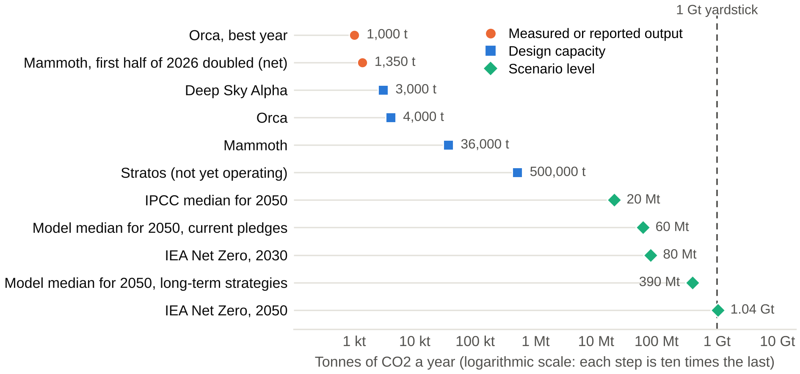

# Summary {#summary}

Direct air capture with durable storage (DACCS) works physically, but on current evidence it is unlikely to remove CO2 at a climate-relevant scale before mid-century (medium confidence). One gigatonne a year, about 2% of today's gross emissions, is a reasonable yardstick; a recent modelling preprint puts the chance of reaching it by 2050 at 4–6%. Measured output at plants with public data is still a few thousand tonnes a year, well below design capacity, and the largest plant had not started operating at last report. Real prices are about $600–1,000 per tonne, and $230–540 by 2050 looks more plausible than the $100 target.

For a committee with a modest budget, the evidence does not support funding a pilot for the tonnes it removes. Today, the same money and clean power usually cut more CO2 elsewhere. A small pilot can still be justified as paid-for learning if it answers a named question existing plants will not answer, publishes independently verified operating data, uses clean energy that would not otherwise displace fossil power, has a reachable durable store, shares costs with other funders and can be stopped at set review points. Where these conditions hold, co-funding a shared, open test platform will often teach more per dollar than hosting a single plant. Where they do not, the better-supported choice is to fund emission cuts now, with low-cost preparation at most. Table 4 shows which local conditions change this answer.

The main unresolved points are real-world energy use at scale, whether the largest plant meets its design, and whether demand survives beyond one dominant buyer.

<!-- RESEARCH_BODY_START -->

# Scope, concepts and method {#scope}

Direct air capture (DAC) moves air past a chemical that binds CO2, then uses heat or electricity to release a concentrated stream. Air is only about 0.04% CO2, so large volumes must be handled and energy use is high by nature. The main families are solid sorbents regenerated at modest temperatures (S-DAC), liquid solvents regenerated at up to 900 °C (L-DAC) [[1]](#ref-1), Executive summary, and newer limestone-based or electrochemical routes. DAC becomes *removal* only when the CO2 is stored durably, by deep geological injection or mineralisation. *Net removal* is the CO2 stored minus emissions from building and running the plant.

The review covers all main DAC technologies and global evidence up to 9 November 2026. It assumes no specific region and a modest budget that cannot pay for a commercial-scale plant alone. "Funding pilots" means hosting a pilot or co-funding one elsewhere. Point-source capture and other removal methods appear only as comparators. Engineering design, site-specific modelling, legal or procurement advice and company rankings are excluded; companies are named only as evidence.

This is a structured narrative review, not a systematic one. It favoured peer-reviewed work and public agency data, flags operator figures as self-reported and separates measured from modelled results. Searches, run on 9 November 2026, stopped when further query families on each question returned only known or non-assessable material. Confidence labels are reasoned judgements, not probabilities.

# What the evidence implies for the committee {#implications}

**Q0. Can direct air capture (DAC) with durable storage remove CO2 at a scale that matters for climate goals, and what does that imply for a regional decision on funding pilots?** Physically yes; at a climate-relevant scale by 2050, probably not; after 2050, possibly, if costs, clean energy and storage allow (medium confidence). A regional funder should therefore treat a pilot as a purchase of specific knowledge, not of tonnes. The four premises behind the proposal fare as follows:

- *DAC can reach a meaningful scale:* possible but unproven; not by 2030 and unlikely by 2050 (F1, F2).
- *Costs will fall substantially:* probably by a factor of two to three, but not to $100 per tonne (F4).
- *A regional pilot would teach something new:* only if designed around an unanswered question and open data (F6).
- *DAC is a good use of limited money and clean power:* usually not today, with narrow exceptions (F5).

**Table 1.** Options for a modest budget. Options A and B are the defaults this evidence best supports; C needs the most conditions to hold (this review's inference from F1–F6).

| Option | Evidence supports it when | Main trade-off |
|:-----|:----------|:---------|
| A. Fund emission cuts; no DAC money now | Cheap cuts remain unfunded, or the checks in Table 4 fail | Forgoes local learning; takes no view on later removal needs |
| B. Co-fund an open test platform elsewhere | A credible platform commits to publishing data on a question relevant to the region | Little local control; the return is mostly knowledge |
| C. Host a small pilot | All checks in Table 4 are met, above all a named local question and reachable storage | Very high cost per tonne; operating, storage and reputational risks stay local |
| D. Buy delivered, verified removals | The aim is to support demand and learn about verification | Paying on delivery limits risk but teaches little about technology |
| E. Prepare conditions only | The region may host later, and storage mapping, monitoring skills or public trust are the bottleneck | No tonnes; value depends on later investment |

# Findings by question {#findings}

## Q1. What counts as "a scale that matters": how much DAC do credible climate scenarios need, and by when? {#q1}

**F1.** A useful yardstick is about 1 Gt CO2 a year, which scenarios reach around or after mid-century, if at all; they differ by two orders of magnitude (high confidence on the spread, medium on the yardstick).

The world removes about 2.2 Gt of CO2 a year, some 5% of gross emissions, and 99.9% of that comes from conventional land-based methods; novel methods remove about 2 Mt [[2]](#ref-2). Pathways consistent with 1.5 °C need about 8.75 Gt of removal by all methods in 2050, and national pledges leave a gap of at least 5.2 Gt [[2]](#ref-2). The IPCC calls removal "unavoidable" to counterbalance hard-to-abate residual emissions, at a scale that depends on how far gross emissions fall [[3]](#ref-3), para. C.11.

How much falls to DACCS is much less settled. IPCC scenarios limiting warming to 2 °C or lower have a median of 0.02 Gt a year in 2050 (5–95% range 0–1.74), rising to 1.02 Gt in 2100 (0–12.6) [[4]](#ref-4), Cross-Chapter Box 8. The International Energy Agency (IEA) is far higher, at 80 Mt in 2030 and 1,041 Mt in 2050 [[5]](#ref-5). A model comparison found DACCS complements other methods rather than replacing them, that scale-up speed is the main limit, and that relying on it and then finding it unavailable could add up to 0.8 °C of temporary overshoot [[6]](#ref-6).

Gigatonne scale is a fair threshold because it is about 2.3% of the 44 Gt of gross emissions implied above (2.2 ÷ 0.05; own calculation). Its long-run effect is modest: 50 years at 1 Gt, using an estimate that 1,460 Gt of storage equals at most 0.7 °C [[7]](#ref-7), is about 0.02 °C (50 × 0.7 ÷ 1,460; own calculation). DACCS is therefore a mid-to-late-century complement, not a substitute for emission cuts.

## Q2. How does operating capacity and measured performance compare with announced plans and claims? {#q2}

**F2.** Measured output at plants with public data is in the low thousands of tonnes a year, and plants have run well below design, although recent gains are real (high confidence for named plants; low for a global total).

No audited current global total could be accessed. The latest IEA figure inspected is almost 0.01 Mt a year in 2022 [[1]](#ref-1), p. 8. Figure 1 places the available numbers on one scale.

**Figure 1.** Measured output, design capacity and scenario levels for DAC, in tonnes of CO2 a year. Data: [[8]](#ref-8), [[9]](#ref-9), [[10]](#ref-10), [[1]](#ref-1), [[11]](#ref-11), [[4]](#ref-4), [[12]](#ref-12), [[5]](#ref-5). The Mammoth point is company-reported net removal, annualised by this review. The "model" points come from a preprint. Scenario values are not forecasts.

The gap is clearest at plants with public numbers. Orca, nominally 4,000 t a year, recorded about 1,000 t in its best year, and the operator's Iceland plants about 2,400 t in total from 2021 to early 2025, according to an investigation using registry data and company accounts [[8]](#ref-8). Mammoth, designed for 36,000 t a year from 72 containers, had 12 running in June 2025 and had paused further installation because containers underperformed their prototypes [[13]](#ref-13). The company reports 675 t of net removal in the first half of 2026, against 119 t a year earlier [[9]](#ref-9). That is about 22% of a pro-rata design output for 12 containers and 4% of the whole plant (own calculation; net and design figures are not strictly comparable). The company also says two upgraded containers reach the design rate of 1.37 t a day at a 40–50% capacity factor [[9]](#ref-9); this is self-reported, and on those figures a fully built plant would reach about 14,400–18,000 t a year, not 36,000 (own inference).

Stratos, a 500,000 t liquid-solvent plant in Texas, slipped from mid-2025 to end-2025 to the second quarter of 2026 before a non-process fault emerged during commissioning [[11]](#ref-11). In August 2026 its operator expected full commissioning to begin around the end of the year and operations in 2027 [[14]](#ref-14). The core technology was reported as performing as expected in tests [[11]](#ref-11), but the sources inspected report no capture volumes. Public support is unstable too: the two largest US DAC hubs were kept on a preserved grant list in April 2026, but the 2027 budget request would rescind $2.3 billion of the $3.5 billion programme [[15]](#ref-15). Across novel removal methods, only about 20% of planned capacity has been delivered [[16]](#ref-16).

If Stratos delivers 0.5 Mt in 2027, reaching 1 Gt by 2050 needs about 39% growth a year for 23 years. Novel removal has recently grown about 40% a year [[2]](#ref-2), so the rate is not impossible, but it would have to hold for a generation and from nameplate rather than measured output. The IEA's 2030 level would need about a fivefold increase every year for three years (own calculations). A preprint using Monte Carlo simulation across two policy scenarios gives median 2050 removals of 0.06 Gt under current pledges and 0.39 Gt under long-term strategies, with about a 4% and 6% chance of a gigatonne by 2050 [[12]](#ref-12), p. 7, Fig. 2. It has not been peer reviewed.

Progress is real elsewhere too. Deep Sky's Alpha site in Alberta began storing CO2 in August 2025 [[10]](#ref-10), and its first DAC credits, certified net of project emissions, were issued in June 2026 [[17]](#ref-17), although tonnage was not stated. This review found no peer-reviewed, full-year operating dataset from a commercial-scale plant.

## Q3. What are the limits from energy, water, land, materials, transport and storage, and how much CO2 is removed after life-cycle emissions? {#q3}

**F3.** Energy and storage are the main limits, rather than land or water, and net removal depends mostly on the energy supply (medium-to-high confidence).

*Energy.* The IEA gives 5.5–9.5 GJ per tonne, mostly as heat [[1]](#ref-1), p. 23. For 1 Gt, that is 5.5–9.5 EJ, or 1,500–2,600 TWh, equal to 5–8% of 2025 world electricity generation of about 31,700 TWh [[18]](#ref-18) (own calculation). An all-electric solid-sorbent model gives a similar 1.35–2.69 MWh per tonne [[19]](#ref-19), Results. Heat need not come from electricity, so this only indicates scale. Operating plants may be well above these figures: an investigation attributes 5,000–6,000 kWh per tonne to a company executive [[8]](#ref-8), a second-hand figure. California's latest demonstration programme sets a target of 1,400 kWh per tonne at most [[20]](#ref-20), Sect. I.C.

*Net removal.* Life-cycle studies of Climeworks' plants found 85.4% at Hinwil and 93.1% at Hellisheiði [[21]](#ref-21). A comparative study found 0.7–0.85 t net per tonne captured for solid sorbents [[22]](#ref-22) and, for a liquid-solvent baseline, 41%, or 70% with co-capture of calciner emissions [[23]](#ref-23). A grid-powered heat-pump design ranges from 9% to 95% depending on the grid [[1]](#ref-1), pp. 37–38. A dirty grid can nearly cancel the benefit.

*Storage.* A risk-screened estimate puts prudent geological capacity at 1,460 Gt, against about 12,000 Gt in theory [[7]](#ref-7). The authors' screening rests on precautionary judgement, but the figure shows storage is a shared, finite resource. Developing a site can take up to ten years [[1]](#ref-1), p. 12. Transport and storage costs are modest at scale (the IEA assumes $20 per tonne [[1]](#ref-1), p. 38) but high for small sources: EU modelling for cement and lime plants gives €34–209 per tonne without pipelines, and a €38 median with widespread storage and pipelines [[24]](#ref-24). Another study found distance does not strongly affect net cost [[25]](#ref-25), p. 906; the difference reflects scale, so small pilots face the upper end.

*Water, land and materials.* Solid sorbents can produce water; liquid solvents can need up to 50 t per tonne of CO2 [[1]](#ref-1), pp. 23, 39. Plant land use is 0.4–1.7 km² per Mt [[1]](#ref-1), p. 23, before energy supply is counted. Amine production would need to grow more than tenfold for solid sorbents to capture 1% of global emissions [[21]](#ref-21).

*Climate.* In one model, solid-sorbent cost averages $365–462 per tonne across climate types at $50 per MWh, and sites very cold for long periods perform poorly [[19]](#ref-19), Table 1. The IEA says more testing is needed in very dry, humid or polluted climates [[1]](#ref-1), p. 10.

## Q4. What does DAC cost now, how far might costs plausibly fall, and who pays? {#q4}

**F4.** Real prices are about $600–1,000 per tonne; a fall to roughly $230–540 by 2050, the central range in one peer-reviewed projection, is more plausible than $100, and demand is fragile (medium confidence).

**Table 2.** Cost evidence, in US dollars per tonne CO2. Figures use different years and system boundaries, so they are not pooled.

| Estimate | What it measures | Status |
|:---|:---------|:------|
| About 1,000 | Company's current cost, May 2025 [[26]](#ref-26) | Self-reported |
| About 650 | Median disclosed price, tonnage-weighted [[27]](#ref-27) | Market data, working paper |
| 458 / 670 | Buyer "good value" / supplier break-even, survey for 2025 [[28]](#ref-28) | Survey, 11 buyers, 18 suppliers |
| 245–1,076 | Net removal cost, US designs, after tax credit [[27]](#ref-27) | Modelled, working paper |
| 125–335 | Large plant, capture only, excludes transport and storage [[1]](#ref-1), pp. 8, 28 | Modelled, 2022 |
| 94–232 | 1 Mt plant designed from pilot data [[29]](#ref-29) | Modelled by developer's staff |
| 260–620; over 2,000 | First-of-a-kind, liquid solvent; solid sorbent median [[25]](#ref-25), pp. 903, 907 | Modelled |
| 226–544; 281–579; 230–835 | At 1 Gt a year: solvent; sorbent; calcium oxide (90% interval) [[30]](#ref-30) | Modelled |
| 100–600 | Plateau about 2050, four technologies, high uptake [[25]](#ref-25) | Modelled |

Estimates diverge mainly over what they count: capture alone or with storage, first plant or mature fleet, gross or net tonnes. One operator expects unit costs to fall two- to threefold within a decade [[26]](#ref-26). The IEA's 2022 suggestion of below $100 by 2030 in high-renewable locations [[1]](#ref-1), p. 9 now looks optimistic (own judgement). Even the low end in one study requires learning rates of 15–19%, gas at about $3 per GJ, electricity at about $0.09 per kWh and a roughly 50% cut in energy use [[25]](#ref-25), p. 910. "Learning" here means costs falling as cumulative production grows; complex, customised systems tend to learn slowly [[31]](#ref-31), and projections that account for this are higher than earlier ones [[30]](#ref-30). A working paper's long-term case reaches $182–207 with learning and cleaner power [[27]](#ref-27), pp. 63–64, so the range remains open.

Who pays is the larger uncertainty. The US tax credit is $180 per tonne for geological storage [[32]](#ref-32). The EU adopted a certification method for permanent removals, in force from 7 May 2026, but removals were not yet part of its trading system at the time of that account [[33]](#ref-33). Microsoft accounted for 78.5% of disclosed durable purchases as of April 2026 [[34]](#ref-34). That month it was reported to be pausing new purchases, and it said only that it may "adjust the pace or volume" [[35]](#ref-35). Biomass-based routes took 96% of 2025 purchases [[34]](#ref-34). The preprint noted above finds that peak subsidies below about $425 per tonne yielded no gigatonne-scale deployment, and that subsidy and market factors mattered more than technology parameters [[12]](#ref-12), pp. 7–8. A regional budget cannot change this.

## Q5. How does it compare with other uses of the same money and clean power, including emission cuts and other carbon removal methods? {#q5}

**F5.** Today the same money and clean power usually achieve more through emission cuts, and other removal methods are cheaper per tonne but carry different risks (medium-to-high confidence for cuts; medium for other removals).

*Money.* The IPCC finds options costing $100 per tonne or less could cut global emissions by at least half the 2019 level by 2030, with more than half that potential below $20 [[3]](#ref-3), paras. C.12, C.12.1. Current DAC prices are several times higher. A 2026 US study compared DAC with wind and solar across grid regions to 2050: renewables were more cost-effective in three of four DAC scenarios, and DAC won only with a breakthrough to 800 kWh and $100 per tonne, and even then not in the coal-heavy Midwest; under moderate assumptions, California was the one exception, from 2035 [[36]](#ref-36). The article itself could not be opened, and results are US-specific and include health benefits.

*Clean power.* A simple test (own illustrative calculation, using the target and model figures under F3): at 1.4–2.7 MWh per tonne and 85% net efficiency, a megawatt-hour spent on DAC removes about 0.3–0.6 t. The same megawatt-hour on the grid displaces whatever would otherwise run. If that marginal power emits more than about 0.3–0.6 t per MWh, displacing it wins; coal typically exceeds this range and efficient gas sits near its lower end (rounded textbook values, not measured for any grid). At the 5,000–6,000 kWh reported above, the break-even falls to about 0.15 t per MWh. The calculation reverses only where clean power is truly surplus or the grid is already nearly carbon-free.

**Table 3.** DACCS and other removal methods. Costs and readiness (1–9 scale) from the IPCC, 2022 [[4]](#ref-4), Table 12.6; prices are tonnage-weighted medians from 2026 [[27]](#ref-27). Biochar is reported within a wider biomass category.

| Method | IPCC cost ($/t) | Readiness | Median disclosed price ($/t) | Key limit or risk |
|:-----|:----|:---|:----|:--------|
| DACCS | 100–300 (84–386) | 6 | About 650 | Energy, cost |
| BECCS | 15–400 | 5–6 | About 214 | Biomass supply |
| Biochar | 10–345 | 6–7 | About 382 | Biomass supply |
| Enhanced weathering | 50–200 (24–578) | 3–4 | About 368 | Verification |
| Afforestation | 0–240 | 8–9 | Not in this source | Reversal risk |

A single ranking would mislead: lower modelled cost tends to coincide with harder measurement, whereas DAC and bioenergy capture can meter CO2 directly [[27]](#ref-27). DAC's distinct strengths are metered tonnes, small land needs and independence from biomass. A hypothetical budget of $5 million buys about 5,000–7,700 t of DAC removal at $1,000–650 per tonne, or about 23,000 t of BECCS at $214 (own calculation). For a region emitting 10 Mt a year, the DAC tonnes are at most 0.08% of one year's emissions (hypothetical).

## Q6. What can pilots actually teach, what have earlier ones shown, and what should a regional funder check first? {#q6}

**F6.** Pilots can settle local and system-integration questions, but not costs at commercial scale; their value depends on open data, enough operating time and a question not already covered (medium confidence).

*What earlier pilots showed.* The Squamish pilot in Canada (0.6 t a day) tested the main components and supported a design, but left out gas cleanup and CO2 compression and ran its calciner in batches; its authors worked for the developer, and they judged about 100,000 t a year the smallest economic size for the full process [[29]](#ref-29). Small liquid-solvent pilots therefore transfer poorly to commercial cost (own inference). At Climeworks, staff reported that prototype filter problems carried into Mammoth, and that "the moment that you learn something at Orca, you've already designed your first version of Mammoth" [[13]](#ref-13): compressed timelines waste the learning. Stratos was delayed by a non-process component [[11]](#ref-11), a reminder that integration, not only chemistry, can fail. Among carbon capture projects more broadly, over 100 of 149 worldwide were terminated or put on hold; in a US sample, 13 of the 14 most expensive were abandoned, and credible revenue was a key discriminator [[37]](#ref-37), Sects. 1, 3.

*Shared platforms.* Alpha aims to run technologies from up to ten companies side by side at up to 3,000 t a year [[10]](#ref-10), but the sources inspected show no commitment to publish results. Norway's carbon capture test centre, a public-private partnership, runs open campaigns and reports more than 70 scientific publications [[38]](#ref-38), by its promoters' account. 

*A benchmark.* California's 2026 call offers $2.5–5.5 million per award, requires at least 20% matching funds and 7% for community work, and sets end-of-project targets of at most $450 per tonne and at least 500 t a year net, with project-specific baselines and third-party verification [[20]](#ref-20), Sects. I.C, I.D. A project at the top of that range running 500 t a year for three years would cost about $4,400 per tonne (5.5 × 1.2 ÷ 1,500; own hypothetical calculation). Only the knowledge can justify that price.

*What it can and cannot teach.* A regional pilot can show performance in an under-tested climate, integration with local heat or surplus power, real net removal, the permitting and storage chain, and public response. It cannot show cost at commercial scale, which depends on cumulative production [[31]](#ref-31). In a US study, support was conditional on participation, benefits and trust; funding from general taxes lowered support, while community involvement and long-term jobs raised it, by small margins [[39]](#ref-39). Table 4 orders the checks.

**Table 4.** Local conditions that change the answer, in the order to check them. The 0.3 t per MWh threshold comes from F5; other criteria are inferences from F2–F6.

| Check | Supports funding when | Argues against when |
|:---|:---------|:---------|
| 1. Learning question | It names an unknown existing plants will not resolve | It repeats known tests or targets tonnes or publicity |
| 2. Open data | Net capture, energy, downtime and sorbent life are published and independently verified | Data stay proprietary or self-reported |
| 3. Energy | Clean supply is additional or surplus, or waste heat is available; local marginal emissions are below about 0.3 t per MWh | Grid is fossil-marginal, or clean power is diverted from displacing fossil generation |
| 4. Storage | A licensed durable store or established route exists within the project period | No store is in reach, or CO2 goes to short-lived uses |
| 5. Climate and water | Local climate is under-tested and relevant elsewhere | Extreme cold, or water scarcity with liquid solvents |
| 6. Money | Other funders share the cost, and cheaper cuts are already funded | The region is sole payer, or cheap cuts remain unfunded |
| 7. Time and exit | A year or more of full-system operation, with stop criteria | Commitment to scale before results |
| 8. Community | Shared decisions, a funded engagement plan, long-term local jobs | Late or token engagement; unresolved distrust |

# Limitations and unresolved questions {#limitations}

Evidence on real performance is thin and mostly operator-reported or journalistic; net and gross figures are not always comparable. Sources were read through an automated full-text extraction tool rather than page by page, and locators come from it. Several sources could be read only indirectly, including the State of Carbon Dioxide Removal report, the US renewables study and the storage-limit paper; the references say how each was read. IEA tracking pages were inaccessible, so no current global total is given. Two sources (the Chiani preprint and the Holler working paper) are not peer reviewed. The evidence leans towards the United States and northern Europe.

**Unresolved:** real-world energy use at scale; whether Stratos meets design; sorbent life in the field; durable demand beyond one buyer; and how much DACCS the world will need, which depends on residual-emission choices.

# Conclusion {#conclusion}

DACCS can remove CO2, but evidence that it can reach about a gigatonne a year by 2050 is weak, and it should not be counted on as a substitute for emission cuts. Its case rests on later decades and on residual emissions that are hard to avoid. For a regional committee, this means funding DAC pilots is justified only as a bounded purchase of knowledge, when the checks in Table 4 hold. Otherwise the money and clean power are better spent on emission cuts.

<!-- RESEARCH_BODY_END -->

# References {#references}

### [1] Direct Air Capture: A key technology for net zero {#ref-1}

International Energy Agency (2022). IEA, Paris. https://iea.blob.core.windows.net/assets/78633715-15c0-44e1-81df-41123c556d57/DirectAirCapture_Akeytechnologyfornetzero.pdf

### [2] Q&A: The current state of carbon dioxide removal around the world {#ref-2}

Carbon Brief (2026), republished by Resilience, 8 June. Secondary account of Edwards et al., State of Carbon Dioxide Removal, 3rd edition; report not accessible. https://www.resilience.org/stories/2026-06-08/the-current-state-of-carbon-dioxide-removal-around-the-world/

### [3] Summary for Policymakers {#ref-3}

IPCC (2022). In Climate Change 2022: Mitigation of Climate Change, AR6 WGIII. https://www.ipcc.ch/report/ar6/wg3/downloads/report/IPCC_AR6_WGIII_SummaryVolume.pdf

### [4] Cross-sectoral perspectives (Chapter 12) {#ref-4}

IPCC (2022). In AR6 WGIII. https://www.ipcc.ch/report/ar6/wg3/chapter/chapter-12

### [5] Net Zero Roadmap: A Global Pathway to Keep the 1.5 °C Goal in Reach, CCUS section {#ref-5}

International Energy Agency (2023). https://www.iea.org/reports/ccus

### [6] An inter-model assessment of the role of direct air capture in deep mitigation pathways {#ref-6}

Realmonte, G. et al. (2019). Nature Communications 10, 3277. Abstract read via repository record. https://doi.org/10.1038/s41467-019-10842-5

### [7] A prudent planetary limit for geologic carbon storage {#ref-7}

Gidden, M. J. et al. (2025). Nature. Read through the IIASA release and the authors' Carbon Brief guest post. https://doi.org/10.1038/s41586-025-09423-y

### [8] Climeworks' capture fails to cover its own emissions {#ref-8}

Alexandersson, B. O. Þ. & Grettisson, V. (2025). Heimildin, 15 May. Investigative journalism. https://heimildin.is/FGY3

### [9] Climeworks doubles CO2 capture at its Mammoth plant {#ref-9}

Winss Solutions (2026), 13 September. Secondary account of a company announcement; self-reported; company post not opened. https://www.winssolutions.org/climeworks-mammoth-direct-air-capture-upgrade/

### [10] Canadian carbon removal plant begins storing CO2 underground {#ref-10}

Hiar, C. (2025). E&E News, 20 August. https://www.eenews.net/articles/canadian-carbon-removal-plant-begins-storing-co2-underground

### [11] Stratos DAC delay: inside the holdup at the world's largest carbon capture plant {#ref-11}

Bush, T. (2026). Decarbonfuse, 9 June. https://decarbonfuse.com/posts/stratos-dac-delay-inside-the-holdup-at-the-world-s-largest-carbon-capture-plant

### [12] The uncertain policy price of scaling direct air capture {#ref-12}

Chiani, L. et al. (2026). arXiv:2603.19143v1, preprint, not peer reviewed. https://arxiv.org/pdf/2603.19143

### [13] On the ground at Climeworks' biggest DAC project {#ref-13}

Allsup, M. (2025). Latitude Media, 11 June. https://www.latitudemedia.com/news/on-the-ground-at-climeworks-biggest-dac-project

### [14] Occidental (OXY) Q2 2026 earnings call transcript {#ref-14}

Motley Fool (2026), call of 6 August. https://www.fool.com/earnings/call-transcripts/2026/08/12/occidental-oxy-q2-2026-earnings-call-transcript/

### [15] DOE restores $1.2B for DAC hubs and 5 hydrogen projects {#ref-15}

Decarbonfuse (2026), April. https://decarbonfuse.com/posts/doe-restores-1-2b-for-dac-hubs-and-5-hydrogen-projects

### [16] News release on the third edition of the State of Carbon Dioxide Removal report {#ref-16}

EurekAlert! (2026), 2 June. https://www.eurekalert.org/news-releases/1130360

### [17] North America's first direct air capture certificates {#ref-17}

Isometric (2026), 29 June. Certifier's statement. https://isometric.com/writing-articles/north-americas-first-direct-air-capture-certificates

### [18] Global Electricity Review 2026: 2025 in review {#ref-18}

Ember (2026). World total inferred from renewables at 10,730 TWh and a 33.8% share. https://ember-energy.org/chapter/2025-in-review/

### [19] Geospatial analysis of regional climate impacts to accelerate cost-efficient direct air capture deployment {#ref-19}

Sendi, M., Bui, M., Mac Dowell, N. & Fennell, P. (2022). One Earth 5, 1153–1164. https://doi.org/10.1016/j.oneear.2022.09.003

### [20] GFO-25-307: Direct Air Capture Pre-Commercial Demonstration and Community Engagement, solicitation manual {#ref-20}

California Energy Commission (2026). https://www.energy.ca.gov/sites/default/files/2026-05/00_GFO-25-307_Solicitation%20Manual_ada.docx

### [21] Life-cycle assessment of an industrial direct air capture process based on temperature-vacuum swing adsorption {#ref-21}

Deutz, S. & Bardow, A. (2021). Nature Energy 6, 203–213. Abstract read. https://doi.org/10.1038/s41560-020-00771-9

### [22] Understanding environmental trade-offs and resource demand of direct air capture technologies through comparative life-cycle assessment {#ref-22}

Madhu, K. et al. (2021). Nature Energy. Read through a press account: https://phys.org/news/2021-10-technologies-climate-efficiency-carbon-dioxide.html

### [23] Addendum to the Madhu et al. life-cycle assessment {#ref-23}

Madhu, K., Pauliuk, S., Dhathri, S. & Creutzig, F. (2023). Nature Energy 8, 901–902. https://www.nature.com/articles/s41560-023-01312-w.pdf

### [24] Key insights on EU CO2 transport and storage costs {#ref-24}

Clean Air Task Force (2025), 24 November. NGO modelling. https://www.catf.us/2025/11/key-insights-eu-co2-transport-and-storage-costs/

### [25] The cost of direct air capture and storage can be reduced via strategic deployment but is unlikely to fall below stated cost targets {#ref-25}

Young, J. et al. (2023). One Earth 6, 899–917. https://doi.org/10.1016/j.oneear.2023.06.004

### [26] Interview with Jan Wurzbacher, co-CEO of Climeworks {#ref-26}

SWI swissinfo.ch (2025), 12 May. Self-reported. https://www.swissinfo.ch/ger/klimaschutz/wir-wollen-bis-2050-eine-milliarde-tonnen-co%e2%82%82-j%c3%a4hrlich-abscheiden/89281627

### [27] Cost comparisons for emerging carbon dioxide removal technologies {#ref-27}

Holler, P. & Reichelstein, S. (2026). University of Mannheim working paper, August; not peer reviewed. https://www.uni-mannheim.de/media/Einrichtungen/mises/Dokumente/260820_Comparative_Carbon_Removal.pdf

### [28] Durable CDR pricing survey {#ref-28}

CDR.fyi & OPIS (2025), fielded October–December 2024. https://www.cdr.fyi/reports/pricing-survey-jan-2025.pdf

### [29] A process for capturing CO2 from the atmosphere {#ref-29}

Keith, D. W., Holmes, G., St. Angelo, D. & Heidel, K. (2018). Joule 2(8), 1573–1594. Authors employed by developer. https://doi.org/10.1016/j.joule.2018.05.006

### [30] Considering technology characteristics to project future costs of direct air capture {#ref-30}

Sievert, K. et al. (2024). Joule. Abstract and a press account read. https://doi.org/10.1016/j.joule.2024.02.005

### [31] Accelerating low-carbon innovation {#ref-31}

Malhotra, A. & Schmidt, T. S. (2020). Joule 4(11), 2259–2267. Abstract read. https://www.research-collection.ethz.ch/items/2924f068-fca7-4263-b51b-4e39127f60e5

### [32] U.S. preserves and increases 45Q credit in One Big Beautiful Bill Act {#ref-32}

Global CCS Institute (2025). https://www.globalccsinstitute.com/u-s-preserves-and-increases-45q-credit-in-one-big-beautiful-bill-act/

### [33] New EU certification framework for permanent carbon removals takes effect in May 2026 {#ref-33}

Thommessen (2026). https://www.thommessen.no/en/news/new-eu-certification-framework-for-permanent-carbon-removals-takes-effect-in-may-2026

### [34] Durable CDR market update: from ambition to execution {#ref-34}

CDR.fyi (2026), 12 June. https://www.cdr.fyi/blog/durable-cdr-market-update-carbon-unbound-east-coast-2026

### [35] Is carbon removal in trouble? {#ref-35}

Crownhart, C. (2026). MIT Technology Review, 16 April. https://technologyreview.com/2026/04/16/1135928/carbon-removal-microsoft

### [36] Study comparing direct air capture with wind and solar across US grid regions {#ref-36}

Kashtan, Y. et al. (2026). Communications Sustainability, article s44458-026-00068-0. Article not opened; read through the PSE Healthy Energy summary of 4 May 2026. https://www.psehealthyenergy.org/work/direct-air-capture-opportunity-cost-health-renewables/

### [37] Explaining successful and failed investments in U.S. carbon capture and storage using empirical and expert assessments {#ref-37}

Abdulla, A., Hanna, R., Schell, K. R., Babacan, O. & Victor, D. G. (2021). Environmental Research Letters 16, 014036. https://doi.org/10.1088/1748-9326/abd19e

### [38] Technology Centre Mongstad: capturing the future of global decarbonisation {#ref-38}

Business Norway (undated). Promotional. https://businessnorway.com/articles/technology-centre-mongstad-capturing-the-future-of-global-decarbonisation

### [39] Communities conditionally support deployment of direct air capture for carbon dioxide removal in the United States {#ref-39}

Scott-Buechler, C. et al. (2024). Communications Earth & Environment 5, 175. https://doi.org/10.1038/s43247-024-01334-6

Research ID: direct-air-capture-regional-pilots-2026-11 · Report 1.0 · Scope: direct-air-capture-regional-pilots.rb.md · Protocol 1.7b.10
