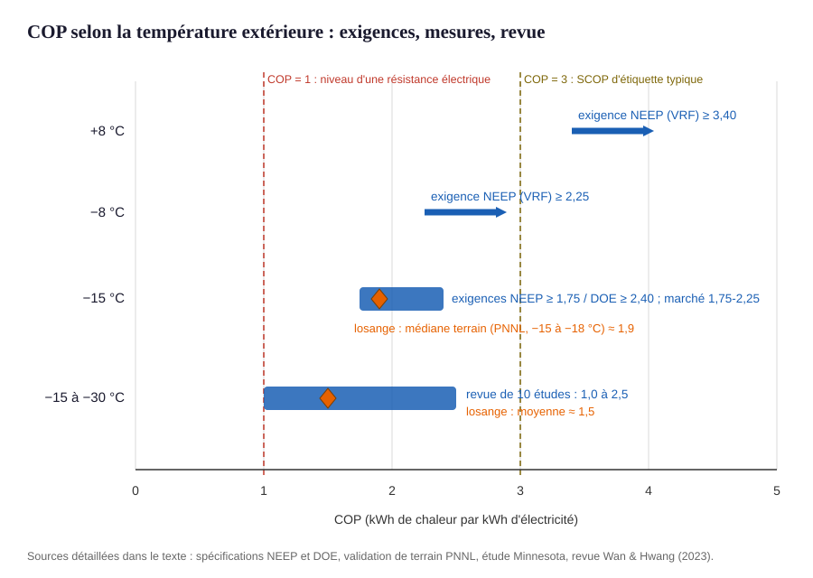
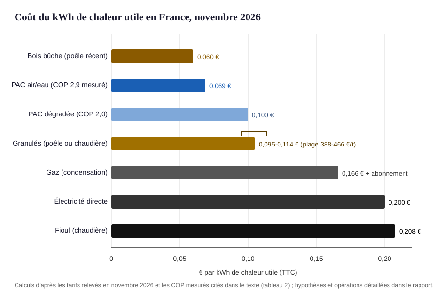
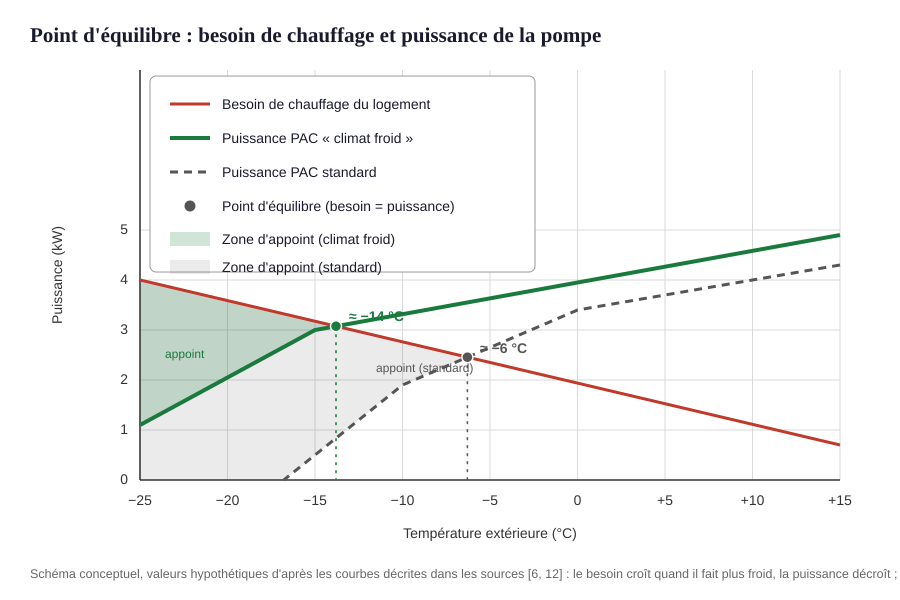

# Pompes à chaleur en climat froid : performances réelles, rentabilité et conditions de choix

*Revue de preuves pour le chauffage résidentiel — données françaises mises en avant*

Langue : français · Date de finalisation : 9 novembre 2026

## Résumé

Une pompe à chaleur reste performante et rentable en climat froid, à des conditions précises. Le coefficient de performance (COP) baisse continûment quand il fait plus froid : les modèles « climat froid » récents maintiennent une puissance proche du nominal et un COP ≥ 1,75 à −15 °C en laboratoire, et les prototypes du programme américain DOE atteignent COP ≥ 2,4 avec 100 % de puissance à −15 °C [[5]](#ref-5) [[6]](#ref-6). Sur le terrain, la campagne française ADEME mesure un COP annuel moyen de 2,9 (air/eau, maisons individuelles), les bonnes installations dépassant 4 — mais un tiers des installations sont améliorables par des réglages ou une pose soignée [[1]](#ref-1) [[3]](#ref-3). Il n'existe pas de seuil de température en dessous duquel la pompe « ne vaut plus le coup » : même entre −15 et −30 °C, les COP mesurés vont de 1,0 à 2,5 (moyenne ≈ 1,5) [[7]](#ref-7). En France, aux tarifs de novembre 2026, la pompe à chaleur produit le kWh de chaleur le moins cher avec le bois bûche : environ 0,069 €/kWh utile contre ≈ 0,17 € pour le gaz et ≈ 0,21 € pour le fioul (calcul d'après les tarifs cités) — elle bat le gaz dès un COP ≈ 1,2. L'appoint de secours n'est systématique qu'au-delà du point d'équilibre, et son coût réel reste faible si l'installation est bien dimensionnée [[9]](#ref-9). Enfin, les émissions de gaz à effet de serre sont réduites d'un facteur 8 à 10 par rapport aux chaudières fioul ou gaz en France [[3]](#ref-3), et d'au moins 20 % partout dans le monde, fuites de fluide frigorigène comprises [[14]](#ref-14).

---

<!-- RESEARCH_BODY_START -->

## 1. Périmètre et concepts {#scope}

Cette étude examine le chauffage des bâtiments résidentiels en climat froid, avec un intérêt particulier pour la plage +7 °C à −25 °C, pour les pompes à chaleur air-air et air-eau — y compris les modèles dits « climat froid » — comparées au gaz, au fioul, au chauffage électrique direct et au bois. Les pompes à chaleur géothermiques servent de point de comparaison. Les données françaises sont mises en avant quand elles existent, sans exclure les travaux nord-américains, nordiques et allemands, qui offrent les mesures de terrain les plus documentées en climat froid. Sont exclus : les bâtiments tertiaires et industriels, la climatisation comme usage principal, les catalogues d'aides pays par pays et la conception de politique publique.

Quatre notions suffisent pour suivre les preuves :

- **COP (coefficient de performance)** : rapport entre la chaleur restituée et l'électricité consommée. Un COP de 3 signifie : 3 kWh de chaleur pour 1 kWh d'électricité. Il dépend de la température extérieure (la « source froide » se raréfie), de la température de l'eau envoyée dans les radiateurs, et de la machine.
- **SCOP / SPF** : le COP « de saison », c'est-à-dire la moyenne pondérée sur tout l'hiver. Le SCOP est la valeur d'étiquette européenne (calculée sur un climat type) ; le SPF désigne la même idée mesurée sur le terrain. L'écart entre les deux est un fil conducteur de ce rapport.
- **Température de base** : la température extérieure de référence du site pour dimensionner un chauffage (minima nocturnes observés sur 30 ans, atteints plusieurs jours par an). En France métropolitaine, elle va de −2 °C sur certaines côtes à −15 °C en Alsace-Lorraine, et descend encore avec l'altitude : −19 °C à Briançon (1 200 m), jusqu'à −29 °C dans les hautes vallées [[26]](#ref-26). C'est le froid « officiel » contre lequel un installateur dimensionne.
- **Point d'équilibre et appoint** : quand il fait froid, la puissance d'une pompe à chaleur baisse tandis que les besoins du logement augmentent. La température où la pompe ne peut plus couvrir seule le besoin est le point d'équilibre. En dessous, un **appoint** prend le relais : résistance électrique, chaudière ou poêle existant. Le **dégivrage** (inversion temporaire du cycle pour faire fondre le givre de l'échangeur extérieur) consomme de l'énergie et réduit brièvement la chaleur disponible.

## 2. Méthode et base de preuves {#methode}

Il s'agit d'une revue narrative structurée, non exhaustive et non systématique. Les sources retenues sont des mesures de terrain instrumentées (campagne ADEME/Enertech sur 100 pompes à chaleur françaises [[1]](#ref-1) ; 77 pompes suivies quatre ans par Fraunhofer ISE [[9]](#ref-9) ; 8 foyers du Minnesota suivis par le Center for Energy and Environment [[8]](#ref-8) ; 22 sites du programme DOE [[6]](#ref-6)), des essais et spécifications de laboratoire (NEEP [[5]](#ref-5), DOE [[7]](#ref-7)), des revues documentaires publiées (Nordsyn pour les pays nordiques [[11]](#ref-11)), des documents d'agences publiques (ADEME, IEA, RTE) et des relevés de prix français de novembre 2026. Les affirmations commerciales ne sont retenues que confrontées à des mesures indépendantes ; une brochure constructeur est citée uniquement comme affirmation d'industrie [[12]](#ref-12).

Les prix et fourchettes de coûts proviennent, faisant état de leur nature, de comparateurs commerciaux français inspectés en novembre 2026 ; ils servent d'ordres de grandeur datés, pas de devis. Les calculs économiques de ce rapport sont des calculs originaux transparents : chaque input est cité et les opérations sont montrées. Les accès partiels sont signalés (le rapport ADEME complet de 227 pages n'a été consulté que par sa table des matières et via les synthèses officielles de l'agence ; l'avis ADEME complet est derrière un formulaire de courriel). La recherche s'arrête lorsque les familles de requêtes (performances mesurées, économie du chauffage, bilan environnemental, tarifs français) n'ont plus produit que des sources déjà connues ou redondantes — les données indépendantes en dessous de −25 °C étant rares, cette limite est traitée comme une frontière de preuve, pas comme une absence de résultat.

## 3. Performances entre +7 °C et −25 °C {#q1}

### 3.1 Une dégradation continue, pas un seuil

**F1 — Le COP baisse de façon continue entre +7 °C et −25 °C ; aucun seuil physique ne fait décrocher la pompe à chaleur, mais la pente s'accentue sous −8 °C. {#f1}**

Les mesures convergent sur une décroissance régulière. En laboratoire, la spécification américaine « climat froid » de NEEP exige COP ≥ 1,75 à −15 °C — son point d'essai le plus froid ; les points d'essai réglementaires sont +8 °C et −8 °C, auxquels les minima exigés pour les systèmes VRF sont respectivement COP ≥ 3,40 et ≥ 2,25 [[5]](#ref-5). La revue de dix études menée pour le programme DOE situe les COP des technologies existantes entre 1,0 et 2,5 (moyenne ≈ 1,5) sur la plage −15 °C à −30 °C ; les modèles « climat froid » du marché affichent 1,75 à 2,25 à −15 °C [[7]](#ref-7). Sur le terrain, la validation DOE de 22 prototypes dans des foyers américains et canadiens donne un COP médian de 1,9 dans la tranche −18 à −15 °C (hors appoint et dégivrage), avec des médianes de 1,6 à 2,7 sous −1 °C [[6]](#ref-6). Dans le Minnesota, les COP constructeur mesurés à −8 °C correspondaient, à l'erreur de mesure près, aux valeurs de terrain [[8]](#ref-8).

**F2 — La puissance restituée est le véritable enjeu du froid : les modèles standard décrochent tôt, les modèles « climat froid » maintiennent leur puissance jusqu'à −15 °C, puis déclinent vers −25 °C. {#f2}**

Une pompe standard perd de sa puissance dès +4 °C et ne fournit plus qu'une fraction de sa capacité nominale en dessous de −10 °C, ce qui impose un appoint précoce [[6]](#ref-6). Les spécifications « climat froid » attaquent ce point : le programme DOE impose 100 % de la puissance nominale à −15 °C et un fonctionnement garanti jusqu'à −23 °C (cut-out), avec une option à −29 °C ; NEEP exige un compresseur à capacité variable et publie les courbes de puissance jusqu'à la plus basse température cataloguée par le fabricant [[5]](#ref-5) [[7]](#ref-7). Mitsubishi Electric revendique pour sa gamme « Hyper Heating » 100 % de puissance jusqu'à −15 °C et un fonctionnement jusqu'à −25 °C, la courbe constructeur montrant environ 50 à 75 % de puissance à −25 °C — affirmation d'industrie, cohérente avec les exigences ci-dessus mais non vérifiée indépendamment à cette température [[12]](#ref-12).

La figure 1 rassemble ces plages : entre −15 et −30 °C, une pompe à chaleur délivre encore 1,0 à 2,5 kWh de chaleur par kWh d'électricité — moins qu'en climat doux, mais nettement plus qu'une résistance électrique (COP = 1).

**Figure 1.** COP en fonction de la température extérieure, d'après les sources inspectées : exigences de spécifications (NEEP, DOE), mesures de terrain (PNNL, Minnesota), revue de la littérature (Wan & Hwang) et courbe constructeur (Mitsubishi, puissance seulement). Sources : [[5]](#ref-5) [[6]](#ref-6) [[7]](#ref-7) [[8]](#ref-8) [[12]](#ref-12). La ligne pointillée COP = 1 marque le niveau d'une résistance électrique.

### 3.2 Sur une saison : le SCOP d'étiquette surestime souvent le terrain

**F3 — Sur une saison de chauffe, les SPF mesurés en climat froid s'étagent de ≈ 1,9 à 3,4 pour les machines air, contre des SCOP d'étiquette souvent ≥ 4. {#f3}**

La campagne française ADEME (100 maisons, remplacement de chaudières gaz ou fioul, une année complète de mesures) aboutit à un COP annuel moyen de 2,9 pour les PAC air/eau, les meilleures installations dépassant 4 et les moins bonnes plafonnant vers 1,8 [[1]](#ref-1) [[3]](#ref-3). En Allemagne, le suivi Fraunhofer ISE de 77 pompes à chaleur dans des bâtiments anciens (construits de 1826 à 2001) donne un SPF moyen de 3,4 pour les air/eau (2,6 à 4,9) et 4,3 pour les géothermiques — sans corrélation avec l'année de construction [[9]](#ref-9). La génération précédente du même institut mesurait déjà 2,1 à 3,3 (moyenne 2,6) sur l'hiver 2008-2009 dans des bâtiments peu rénovés chauffés à 50-65 °C [[10]](#ref-10). En climat nordique, l'étude Nordsyn relève pour les air/air des SPF de saison de 2,2 à 2,6 (et 1,8 à 2,1 en comptant tous les auxiliaires), probablement sous-estimés car le fonctionnement à charge partielle y était mal comptabilisé [[11]](#ref-11). Au Minnesota, le COP annuel mesuré toutes conditions confondues (appoint inclus) est de 1,9 pour les systèmes tout-électriques et 1,3 pour les bi-combustibles qui basculent sur le fourneau à propane sous −12 °C [[8]](#ref-8).

**F4 — L'écart entre étiquette et terrain a des causes identifiées : essais de laboratoire trop courts pour le dégivrage, déclarations de capacité à la baisse, réglages et installation défaillants. {#f4}**

L'étude Nordsyn montre que les essais normalisés (trois heures maximum) capturent rarement un cycle de dégivrage complet, que l'étiquette « climat froid » est rarement affichée en Suède et Norvège, et que certains fabricants déclarent leurs machines à une capacité inférieure à la capacité réelle pour gonfler le SCOP calculé [[11]](#ref-11). Côté français, l'ADEME conclut qu'un tiers des installations pourraient être nettement améliorées par des réglages (loi d'eau, anti-cyclage) ou une meilleure pose ; baisser de 10 °C la température de l'eau de chauffage gagne environ un point de COP, ce qui fait des émetteurs surdimensionnés (ou d'un plancher chauffant) le premier levier, devant même l'isolation [[2]](#ref-2) [[3]](#ref-3).

**F5 — Le givre et l'humidité dégradent transitoirement la performance, surtout entre −12 °C et 0 °C. {#f5}**

Le givrage de l'échangeur extérieur est plus rapide quand l'air est humide ; les cycles de dégivrage, fréquents entre −12 °C et 0 °C au Minnesota [[8]](#ref-8), peuvent au pire réduire la puissance de 29 % et le COP de 17 % pendant le cycle [[7]](#ref-7). Ces pertes sont déjà incluses dans les SPF mesurés sur le terrain, mais pas toujours dans les SCOP d'étiquette : c'est une raison structurelle, pas anecdotique, de l'écart F4.

Le tableau 1 récapitule les exigences qui définissent une machine « climat froid ».

| Exigence (mode chauffage) | Spécification NEEP v4.0 [[5]](#ref-5) | Défi DOE CCHP (prototypes) [[7]](#ref-7) |
|---|---|---|
| COP minimal à −15 °C | ≥ 1,75 (à puissance maximale) | ≥ 2,4 (7 à 14 kW) ; ≥ 2,1 au-delà |
| Puissance à −15 °C | publication des données constructeur (pas de plancher imposé) | 100 % de la puissance à +8 °C |
| Fonctionnement garanti | jusqu'à la plus basse température cataloguée | démarrage ≤ −21 °C ; arrêt ≤ −23 °C (option ≤ −29 °C) |
| Compresseur | capacité variable obligatoire | capacité variable ; fluide frigorigène GWP ≤ 750 |

**Tableau 1.** Ce que « climat froid » veut dire dans les spécifications américaines, qui structurent l'offre mondiale de modèles inverter récents. Les exigences européennes (étiquette SCOP, climat « froid » optionnel de la norme EN 14825) sont moins différenciées : l'étude Nordsyn note que l'étiquette « climat froid » est rarement revendiquée en Europe du Nord [[11]](#ref-11).

## 4. Bilan économique : installation, exploitation, facteurs {#q2}

### 4.1 Investissement et aides en France (2026)

**F6 — La pompe à chaleur air/eau coûte à l'achat trois à quatre fois une chaudière gaz à condensation ; les aides publiques réduisent fortement cet écart pour les PAC, alors qu'elles ont été supprimées pour le gaz. {#f6}**

Les fourchettes constatées en 2026, pose comprise : PAC air/eau 10 000 à 18 000 € (8 000 à 10 000 € en monobloc) [[17]](#ref-17) ; PAC air/air 3 000 à 14 000 € (monosplit 3 000-6 000 €, moyenne générale 6 000-9 000 €) [[18]](#ref-18) ; chaudière gaz à condensation 2 500 à 8 500 €, sans aucune aide directe depuis 2026 et avec une TVA à 20 % [[19]](#ref-19) ; chaudière à granulés 12 000 à 20 000 € [[20]](#ref-20) ; poêle à bûches 2 000 à 8 500 € pose comprise. La pompe à chaleur air/eau figure parmi les équipements éligibles à MaPrimeRénov' (plafond de dépense éligible de 12 000 €) ; les montants rapportés pour 2026 sont de l'ordre de 4 000 à 5 000 € selon les revenus, complétés par la prime CEE des fournisseurs d'énergie et la TVA à 5,5 % — barèmes à vérifier au moment du projet, le guichet 2026 ayant rouvert après le vote de la loi de finances [[16]](#ref-16). Sur la base de sa campagne de mesure, l'ADEME évalue la rentabilité d'une PAC air/eau bien réglée à environ 2 ans avec les aides en vigueur pendant la campagne, et 6 à 8 ans sans aide [[3]](#ref-3).

### 4.2 Coût du kWh utile en France, novembre 2026

**F7 — Aux tarifs de novembre 2026, la PAC produit la chaleur la moins chère avec le bois bûche ; l'électricité directe et le fioul sont environ trois fois plus chers. {#f7}**

Le tableau 2 applique les prix relevés (élec TRV 0,2001 €/kWh [[21]](#ref-21) ; gaz prix repère B1 0,1576 €/kWh [[22]](#ref-22) ; fioul 1,7587 €/L, soit 0,177 €/kWh PCI [[23]](#ref-23) ; granulés 388 à 466 €/t, soit 0,081 à 0,097 €/kWh [[24]](#ref-24)) aux rendements usuels. Calcul original, hypothèses affichées.

| Mode de chauffage | Prix de l'énergie | Rendement / COP retenu | Coût du kWh utile | Source des inputs |
|---|---|---|---|---|
| PAC air/eau (COP mesuré ADEME) | 0,2001 €/kWh | 2,9 | **≈ 0,069 €** | [[21]](#ref-21) [[1]](#ref-1) |
| PAC air/eau (SCOP d'étiquette 3) | 0,2001 €/kWh | 3,0 | ≈ 0,067 € | [[21]](#ref-21) [[25]](#ref-25) |
| Bois bûche (poêle récent) | ≈ 98 €/stère | 82 % | ≈ 0,060 € | [[25]](#ref-25) |
| Granulés | 388-466 €/t | 85-90 % | ≈ 0,095-0,114 € | [[24]](#ref-24) |
| Gaz (condensation) | 0,1576 €/kWh PCS | 95 % (PCS) | ≈ 0,166 € + abonnement | [[22]](#ref-22) |
| Électricité directe | 0,2001 €/kWh | 100 % | 0,200 € | [[21]](#ref-21) |
| Fioul | 1,7587 €/L | 85 % | ≈ 0,208 € | [[23]](#ref-23) |

**Tableau 2.** Coût du kWh de chaleur utile en France, novembre 2026. Opérations : PAC : 0,2001 ÷ 2,9 = 0,069 ; gaz : 0,1576 ÷ 0,95 = 0,166 ; fioul : 1,7587 ÷ (9,97 kWh PCI/L × 0,85) = 0,208. Le comparateur indépendant des sources 7monÉnergie aboutit au même classement (0,067 € pour une PAC SCOP 3 ; 0,170 € pour le gaz à son relevé de septembre ; 0,211 € pour le fioul) [[25]](#ref-25). Ces prix bougent : le gaz a pris +52 % en un an [[22]](#ref-22) — le classement PAC/gaz qui en découle n'est donc pas une loi éternelle, mais le résultat d'un rapport de prix qu'il faut re-vérifier.

**Figure 2.** Coût du kWh utile par mode de chauffage (tableau 2). Les barres PAC montrent qu'entre un COP réel de 2,9 et une machine dégradée à 2,0 (installation défaillante), le coût reste inférieur ou égal au bois granulés et très inférieur au gaz.

### 4.3 Sensibilité : à partir de quel COP la PAC gagne-t-elle ?

**F8 — En France, en novembre 2026, la PAC bat le gaz dès COP ≈ 1,2 et le fioul dès COP ≈ 1,0 ; ce point de bascule est la vraie variable économique, plus que le froid lui-même. {#f8}**

Le raisonnement est transparent : la PAC est au niveau de coût du gaz quand Pe × ηg / Pg = COP, soit COP d'équilibre = (prix électricité ÷ prix gaz) × rendement chaudière. Avec 0,2001 €/kWh d'électricité, 0,1576 €/kWh de gaz et un rendement PCS de 95 % : 0,2001 × 0,95 ÷ 0,1576 ≈ 1,21. Contre le fioul (0,177 €/kWh PCI, rendement 85 %) : ≈ 0,96. Autrement dit, même une PAC sous-performante qui tombe à COP 1,5 en plein hiver garde, en moyenne de saison, une avance confortable sur ces énergies. Le tableau 3 montre comment ce seuil bouge avec les prix — c'est l'analyse de sensibilité demandée par la question.

| Scénario de prix | Électricité | Gaz (PCS) | COP d'équilibre PAC vs gaz | Lecture |
|---|---|---|---|---|
| France, nov. 2026 | 0,2001 € | 0,1576 € | **≈ 1,2** | quasi tout COP saisonnier gagne |
| Heures creuses | 0,1589 € | 0,1576 € | ≈ 1,0 | la PAC gagne dès COP > 1 |
| Électricité +50 %, gaz constant | 0,3002 € | 0,1576 € | ≈ 1,8 | reste atteignable (SPF ≥ 2) |
| Gaz −25 % (retour du gaz bon marché) | 0,2001 € | 0,1182 € | ≈ 1,6 | reste atteignable |

**Tableau 3.** COP saisonnier d'égalité de coût avec une chaudière gaz à condensation (rendement 95 % PCS), sous différents scénarios de prix, calcul original d'après [[21]](#ref-21) [[22]](#ref-22). Le contrexemple économique existe pourtant : dans le Minnesota de l'étude de terrain, face au gaz de réseau historiquement bon marché, les PAC bi-combustibles économisaient ~60 % du propane mais restaient marginales face au gaz — la rentabilité dépend donc du couple « prix relatifs + énergie remplacée » [[8]](#ref-8). En Europe, la forte hausse du prix du gaz depuis 2022 (+52 % au cours de la dernière année selon les relevés cités) a mécaniquement tiré le seuil vers le bas [[22]](#ref-22).

**F9 — Les facteurs qui font varier le bilan, par ordre d'importance observée : prix relatifs des énergies, qualité de l'installation et des réglages, émetteurs basse température, température de base du site, isolation. {#f9}**

- **Prix relatifs** : le tableau 3 ; ils dominent tout.
- **Installation et réglages** : un tiers des PAC françaises mesurées sont améliorables ; l'écart entre la meilleure et la moins bonne installation va du simple au double de COP annuel (4 à 1,8) [[1]](#ref-1) [[3]](#ref-3). La loi d'eau calibrée basse et l'anti-cyclage sont les réglages décisifs.
- **Émetteurs** : radiateurs assez grands ou plancher chauffant permettent de fonctionner à 35-45 °C, gagnant ~1 point de COP par −10 °C d'eau [[3]](#ref-3).
- **Température de base du site** : elle fixe la puissance à installer et le besoin d'appoint (section 5) ; la France va de −2 à −15 °C en plaine, jusqu'à −29 °C en montagne [[26]](#ref-26).
- **Isolation** : elle réduit le besoin de chaleur et la puissance à installer (donc l'investissement), mais l'ADEME mesure que le COP d'une PAC bien posée n'est pas conditionné par l'isolation du logement [[2]](#ref-2) [[3]](#ref-3) ; en Allemagne, aucune corrélation n'apparaît entre année de construction et SPF [[9]](#ref-9).
- **Photovoltaïque** : l'autoconsommation solaire améliore encore le coût et l'empreinte (22 à 37 % d'autoconsommation sans batterie, 40 à 83 % avec, sur six couplages mesurés) [[9]](#ref-9).

## 5. L'appoint : quand, sous quelle forme, à quel coût {#q3}

**F10 — L'appoint n'est pas systématique : il devient nécessaire quand la puissance de la pompe ne couvre plus la charge du logement au-dessous du point d'équilibre — ce qui dépend du dimensionnement et de la température de base, pas de la technologie seule. {#f10}**

Une PAC dimensionnée pour couvrir la charge à la température de base du site n'a besoin d'aucun appoint en exploitation normale ; un appoint de sécurité est quand même recommandé (panne, dégivrage prolongé). Si l'on dimensionne moins large — pour des raisons de coût ou de bruit — l'appoint comble l'écart entre la courbe de puissance et la courbe de besoin. La figure 3 illustre cette géométrie.

**Figure 3.** Schéma conceptuel du point d'équilibre : la charge du logement croît quand il fait plus froid, la puissance de la pompe décroît ; leur intersection définit le point d'équilibre. Une PAC « climat froid » déplace ce point vers les températures basses et réduit la zone d'appoint. Illustration hypothétique d'après les courbes décrites dans les sources [[6]](#ref-6) [[12]](#ref-12).

Les formes d'appoint, par coût d'installation croissant et coût d'exploitation décroissant : résistance électrique intégrée (COP = 1, quasi gratuite à installer, chère en usage) ; chaudière ou foyer existant conservé (bi-combustible) ; appoint hydraulique sur ballon. Les prototypes DOE intègrent tous une résistance électrique étagée [[7]](#ref-7).

**F11 — Bien dimensionnée, l'appoint reste marginal dans le bilan : ~1,3 % de l'électricité consommée sur les PAC air/eau allemandes suivies ; mal réglé ou nécessaire chaque hiver, il dégrade nettement le bilan. {#f11}**

Sur les 77 pompes à chaleur de Fraunhofer ISE (hivers relativement doux pendant la mesure), les résistances d'appoint n'ont consommé que 1,3 % de l'électricité des PAC air/eau, et presque rien pour les géothermiques [[9]](#ref-9). Au Minnesota (température de base < −23 °C), l'appoint est inévitable : les systèmes tout-électriques gardent un COP de cycle > 1 même à −22 °C en priorisant la pompe, et les bi-combustibles basculent sur le fourneau sous −12 °C, avec une baisse de la consommation de propane d'environ 60 % ; le COP annuel tombe à 1,3 pour ces derniers, contre 1,9 aux tout-électriques [[8]](#ref-8). Le coût total observé suit la même logique : économies de 30 à 56 % sur la facture des foyers du Minnesota (33 % en moyenne pour les bi-combustibles propane, 53 % pour les tout-électriques remplaçant des radiateurs) [[8]](#ref-8) ; en France, l'ADEME mesure une facture divisée par deux en moyenne (par trois dans les meilleurs cas) et, pour les PAC air/air remplaçant des radiateurs électriques, des consommations d'usage chauffage divisées par deux durablement, y compris pendant les vagues de froid [[3]](#ref-3) [[4]](#ref-4).

**F12 — En pratique française, l'appoint utile se joue au dimensionnement : taille de machine, loi d'eau, et température de base du site. {#f12}**

Trois conséquences pratiques découlent des preuves : (1) dans la plupart des plaines françaises (températures de base de −7 à −15 °C), une PAC « climat froid » correctement dimensionnée couvre la quasi-totalité de la saison sans appoint, ce que confirment les faibles consommations d'appoint mesurées [[9]](#ref-9) ; (2) en montagne ou en Alsace-Lorraine à température de base ≤ −19 °C, il faut soit surdimensionner la PAC, soit prévoir explicitement un appoint dimensionné sur le déficit de puissance à la température de base — la résistance électrique est la solution la plus simple mais son COP de 1 en fait le mode le plus cher à faire tourner ; (3) l'erreur classique à éviter n'est pas l'appoint lui-même mais sa mauvaise régulation : les systèmes qui l'appellent trop tôt (changement de source fixé trop haut, loi d'eau trop haute) paient l'appoint au prix fort [[8]](#ref-8) [[3]](#ref-3).

## 6. Bilan environnemental {#q4}

**F13 — Sur les émissions de gaz à effet de serre du chauffage, la PAC réduit massivement les émissions en France, et les réduit partout ailleurs d'au moins 20 %, fuites de fluide comprises. {#f13}**

Trois ordres de grandeur indépendants convergent. En France : l'électricité produite affiche 19,6 gCO2éq/kWh en 2025 (minimum historique, contre 178 g dans l'Union européenne élargie) [[13]](#ref-13) ; avec le facteur de consommation moyen de l'ADEME (0,052 kgCO2éq/kWh, valeurs 2024) [[15]](#ref-15) et un COP de 2,9, une PAC émet ≈ 18 gCO2éq par kWh de chaleur utile, contre ≈ 216 g pour une chaudière gaz (0,205 kg/kWh PCS facturé ÷ 0,95) — un facteur ≈ 12, cohérent avec la position de l'ADEME d'émissions divisées par 8 à 10 par rapport aux chaudières fioul ou gaz [[2]](#ref-2) [[3]](#ref-3). En Allemagne (mix bien plus carboné), les 77 PAC de Fraunhofer ISE émettent 57 à 68 % de moins que le chauffage gaz, calcul fait même sur les variations horaires du mix [[9]](#ref-9). Au niveau mondial, l'AIE conclut que les PAC réduisent les émissions d'au moins 20 % par rapport à une chaudière gaz même sur une électricité carbonée, et jusqu'à 80 % sur un réseau propre — en tenant compte des fuites de fluides frigorigènes actuels [[14]](#ref-14). En climat froid, le COP plus bas réduit le bénéfice sans l'inverser : diviser le COP par 2 double les émissions par kWh utile, ce qui laisse la PAC française et allemande très en dessous des énergies fossiles.

**F14 — Les fuites de fluide frigorigène et le pic de demande électrique sont les deux points de vigilance. {#f14}**

Les fluides actuels (R-410A, R-32) ont un potentiel de réchauffement élevé ; leurs fuites amenuisent le bénéfice climatique, ce qui justifie des fluides à GWP faible (propane) ou les plafonds GWP ≤ 750 imposés par le programme DOE [[7]](#ref-7) [[14]](#ref-14). L'autre face est le réseau : l'AIE note qu'une PAC sans travaux d'efficacité peut tripler la pointe hivernale d'un foyer, et qu'améliorer de deux classes le bâtiment divise par deux le besoin et réduit d'un tiers la croissance de pointe [[14]](#ref-14) — un argument de dimensionnement, cohérent avec la section 5. Enfin, sur l'électricité consommée, une PAC air/air remplaçant des radiateurs électriques divise par deux durablement la consommation du poste chauffage, vagues de froid comprises (données Linky de 88 logements) [[4]](#ref-4).

Le tableau 4 récapitule les ordres de grandeur français.

| Chauffage | Émissions directes et amont (gCO2éq/kWh utile, ordre de grandeur) | Base de calcul |
|---|---|---|
| PAC air/eau (COP 2,9, élec française) | ≈ 18 | 0,052 ÷ 2,9 [[15]](#ref-15) |
| Chaudière gaz à condensation | ≈ 216 | 0,205 ÷ 0,95 [[15]](#ref-15) |
| Chaudière fioul | ≈ 380 | 3,2 kg/L ÷ (9,97 × 0,85) kWh/L [[15]](#ref-15) |
| Bois (bûche/granulés) | ≈ 33-36 | 0,030 kg/kWh ÷ rendement [[15]](#ref-15) |

**Tableau 4.** Ordres de grandeur d'émissions par kWh utile en France (calculs originaux d'après les facteurs Base Empreinte 2024 relevés par [[15]](#ref-15)). Le bois affiche de faibles émissions « combustion » comptabilisées ainsi, au prix d'une combustion locale plus polluante (particules) non visible dans ce seul indicateur ; le chauffage bois relève aussi d'une ressource locale et d'une charge manuelle.

## 7. Réponse à la question principale : dans quelle mesure, à quelles conditions ? {#q0}

**Q0. Dans quelle mesure une pompe à chaleur constitue-t-elle un choix performant et rentable pour le chauffage d'un bâtiment résidentiel en climat froid, et à quelles conditions ?**

**Oui, dans la mesure large où la machine est adaptée au froid, la pose soignée, l'émetteur basse température et le prix relatif de l'électricité raisonnable — avec une dégradation honnête des performances attendues sous −15 °C.** Les cinq conditions qui ressortent des preuves :

1. **Une machine « climat froid »** (compresseur inverter, fluide GWP faible, puissance maintenue à −15 °C) : les spécifications américaines et les mesures de terrain montrent que la technologie tient ses promesses à −15 °C [[5]](#ref-5) [[6]](#ref-6) ; en dessous de −20 °C, les données indépendantes se raréfient et les affirmations constructeur ne sont plus vérifiées [[7]](#ref-7) [[12]](#ref-12).
2. **Une pose et des réglages vérifiés** : loi d'eau calibrée basse, émetteurs assez grands, anti-cyclage, installateur compétent ; c'est le facteur qui sépare un COP annuel de 4 d'un COP de 1,8 [[1]](#ref-1) [[3]](#ref-3).
3. **Un dimensionnement assumé** : dimensionner sur la température de base du site et décider explicitement de la stratégie d'appoint (aucune, résistance de sécurité, bi-combustible) ; l'appoint coûte peu s'il ne sert presque jamais, beaucoup s'il remplace souvent la pompe [[8]](#ref-8) [[9]](#ref-9).
4. **Un prix relatif de l'électricité qui ne s'envole pas** : le point de bascule économique est un COP d'équilibre d'environ 1,2 face au gaz français de novembre 2026 ; les SPF mesurés en climat froid (1,9 à 3,4) laissent une marge, mais un doublement du prix de l'électricité face à un gaz redevenu bon marché ramènerait le seuil vers 2,2 (tableau 3).
5. **Un usage compatible** : le chauffage principal d'une maison occupée en hiver est le cœur de cible ; les usages très intermittents ou les logements où le bois est déjà disponible et accepté peuvent baser leur choix ailleurs (le bois bûche reste la chaleur utile la moins chère et très bas-carbone, avec sa contrainte de manutention [[25]](#ref-25)).

Sous ces conditions, la réponse aux prémisses à tester du périmètre est : **pas de seuil de température fatidique** (dégradation continue, COP 1,0-2,5 jusqu'à −30 °C) ; **pas de résistance d'appoint systématique** (nécessaire seulement sous le point d'équilibre, et marginale si bien dimensionnée) ; **pas de dégradation systématique de la rentabilité en climat froid** (le COP de saison baisse, mais l'écart de prix avec les énergies fossiles reste net en France comme dans la plupart des pays européens ; le gaz de réseau américain bon marché reste le contre-cas documenté).

Les options conditionnelles qui en découlent, sans prescription :

- **Remplacement d'un chauffage fioul, propane ou tout-électrique** : le cas le plus favorable — facture divisée par deux à trois, émissions divisées par huit à dix, rentabilité de 2 ans avec aides à 6-8 ans sans [[3]](#ref-3) [[8]](#ref-8).
- **Choix face au gaz en zone desservie** : l'exploitation est nettement favorable à la PAC (0,069 vs 0,166 €/kWh utile en novembre 2026), l'investissement est trois à quatre fois plus élevé sans aides côté gaz et avec aides côté PAC ; le calcul penche pour la PAC en remplacement de fin de vie de chaudière, surtout avec l'évolution récente du prix du gaz [[17]](#ref-17) [[19]](#ref-19) [[22]](#ref-22).
- **Site à température de base ≤ −19 °C (montagne, Est)** : PAC climat froid avec appoint dimensionné sur le déficit de puissance, ou alternative bois-granulés dont le coût d'exploitation reste proche de la PAC [[20]](#ref-20) [[26]](#ref-26).
- **Budget serré ou logement petit** : la PAC air/air (3 000-14 000 €) offre une partie du bénéfice sans eau chaude sanitaire ni hydraulique [[18]](#ref-18).

## 8. Limites {#limites}

Les limites de cette étude sont celles de ses preuves. **En dessous de −20 °C, les mesures indépendantes sont rares** : la plage 1,0-2,5 provient d'une revue de dix études, pas d'un essai unique, et les allégations constructeur à −25 °C ne sont pas vérifiées indépendamment. **Le rapport ADEME complet (227 p.) n'a été consulté que via ses synthèses officielles** (avis, communiqué, article) et sa table des matières ; les chiffres clés cités (COP 2,9, facture ÷2, CO2 ÷8-10, rentabilité) sont ceux de l'agence. **Les SPF cités proviennent de climats différents** (France, Allemagne, Nordiques, Minnesota) avec des bornes système et des hivers différents : ils se recoupent en ordre de grandeur mais ne sont pas strictement comparables. **Les prix français sont un instantané du 9 novembre 2026** sur des comparateurs commerciaux inspectés ; le gaz a varié de +52 % en un an, ce qui rappelle que le classement économique doit être re-vérifié au moment de la décision. **Les coûts d'installation sont des fourchettes de marché**, pas des devis, et excluent les cas particuliers (tubage, raccordement, émetteurs à remplacer). Enfin, **aucune situation de logement précise n'a été fournie** : les preuves sont pesées pour la population générale des maisons individuelles en climat froid, et un dimensionnement réel passe par un bilan thermique du bâtiment.

## 9. Conclusion {#conclusion}

Les preuves rassemblées désamorcent les trois doutes du départ. Les pompes à chaleur récentes conçues pour le froid fonctionnent réellement entre +7 °C et −25 °C, avec un COP qui décroît continûment — autour de 2 à −15 °C pour les meilleures machines mesurées, 1 à 2,5 au-delà — et une puissance maintenue jusqu'à −15 °C pour les modèles certifiés « climat froid ». La rentabilité en climat froid est le résultat d'un rapport de prix plus que du climat : en France, aux tarifs de novembre 2026, le point de bascule face au gaz est un COP ≈ 1,2, très en dessous des COP saisonniers mesurés ; face au fioul et à l'électricité directe, l'avance est massive. L'appoint n'est systématique que pour les sites les plus froids et reste marginal quand l'installation est bien dimensionnée. Le bilan environnemental penche sans ambiguïté pour la PAC dans le contexte électrique français, et reste favorable partout ailleurs. Les vraies conditions du choix sont techniques et locales : machine adaptée, pose soignée, émetteurs basse température, dimensionnement à la température de base, et vérification des prix et aides au moment de décider.

<!-- RESEARCH_BODY_END -->

## Références {#references}

### [1] ADEME, Enertech (DUPRET M., BRAMKAMP U.), 2025, « Performance pompes à chaleur : réalisation d'une campagne de mesure sur des pompes à chaleur en résidentiel individuel », rapport final, 227 p. {#ref-1}
Étude commanditée par l'ADEME et la DGEC ; campagne de mesure sur 100 PAC (90 air/eau, 10 eau/eau ou sol/eau) en maisons individuelles, une année complète. Consulté : table des matières et synthèses officielles [[2]](#ref-2) [[3]](#ref-3) [[4]](#ref-4) ; texte intégral non extrait. Miroir public : https://www.actu-environnement.com/media/pdf/news-46893-rapport-ademe-performance-pompes-chaleur.pdf ; référence à la librairie ADEME.

### [2] ADEME, octobre 2025, « Avis sur les performances réelles des pompes à chaleur — focus sur les PAC air/eau en maisons individuelles », Position de l'ADEME, réf. 013063, 9 p. {#ref-2}
Synthèse des études de mesure ADEME ; PDF complet derrière un formulaire de courriel (non consulté) ; page de présentation consultée. https://librairie.ademe.fr/batiment/8634-avis-sur-les-performances-reelles-des-pompes-a-chaleur.html

### [3] ADEME Infos, octobre 2025, « Comment maximiser la performance de votre pompe à chaleur air/eau ? » {#ref-3}
Article de vulgarisation ADEME restituant les résultats de la campagne de mesure : COP moyen mesuré 2,9 (extrêmes ≈ 1,8 et > 4), facture ÷2 à ÷3, CO2 ÷8-10, rentabilité 2 ans avec aides / 6-8 ans sans, loi d'eau (+1 point de COP par −10 °C), appoint. Consulté en intégralité. https://infos.ademe.fr/energies/2025/comment-maximiser-la-performance-de-votre-pompe-a-chaleur-air-eau/

### [4] ADEME, 7 octobre 2025, communiqué de presse « Les pompes à chaleur : une solution à fort potentiel » (dossier de presse). {#ref-4}
Présentation des études ADEME, dont l'étude PAC air/air sur données Linky (88 logements, usages chauffage ÷2 y compris vagues de froid). Consulté. https://www.ademe.fr/presse/communique-national/les-pompes-a-chaleur-une-solution-a-fort-potentiel/

### [5] Northeast Energy Efficiency Partnerships (NEEP), 2023, « Cold Climate Air Source Heat Pump Specification », version 4.0, en vigueur au 1er janvier 2023. {#ref-5}
Spécification volontaire nord-américaine : COP ≥ 1,75 à −15 °C (5 °F), HSPF2 ≥ 7,7-8,5, compresseur à capacité variable, publication des données à +8 °C (47 °F), −8 °C (17 °F), −15 °C (5 °F) et à la plus basse température cataloguée ; VRF : COP ≥ 3,40 à +8 °C et ≥ 2,25 à −8 °C. Consulté en intégralité. https://neep.org/sites/default/files/media-files/cold_climate_air_source_heat_pump_specification_-_version_4.0_final_1.pdf

### [6] MENON V., KEENE K., ROSENBERG S., ROTONDO J.A., NWE K., YOUNG J., WIND W., GOETZLER B. (PNNL / Guidehouse), janvier 2025, « Performance Results from DOE Cold Climate Heat Pump Challenge Field Validation », PNNL-37127, U.S. Department of Energy. {#ref-6}
Validation de terrain (22 sites, États-Unis et Canada, hivers 2022-2024) des prototypes du défi DOE. Consulté : résumé exécutif et sections de résultats (COP médian 1,9 entre −18 et −15 °C ; médianes 1,6-2,7 sous −1 °C). https://www.pnnl.gov/main/publications/external/technical_reports/PNNL-37127.pdf

### [7] MENON V. et al. (PNNL, Guidehouse, DOE), 2024, « Rising Up to the Challenge: Cold Climate Heat Pumps in the Field », ACEEE Summer Study on Energy Efficiency in Buildings. {#ref-7}
Spécification du défi DOE (COP ≥ 2,4 à −15 °C, 100 % de puissance, cut-out ≤ −23 °C, option −29 °C, GWP ≤ 750) ; revue citée de WAN & HWANG (2023) : COP 1,0-2,5 (moyenne ≈ 1,5) de −15 à −30 °C ; revue citée de KONRAD & MACDONALD (2023) : 1,75-2,25 à −15 °C pour le marché ; dégivrage : jusqu'à −29 % de puissance et −17,4 % de COP (WANG et al. 2011, cité). Consulté en intégralité. https://www.aceee.org/wp-content/uploads/ssb2024/Rising%20up%20to%20the%20Challenge%20-%20Cold%20Climate%20Heat%20Pumps%20in%20the%20Field.pdf

### [8] SCHOENBAUER B., BOHAC D., HAYNOR A. (Center for Energy and Environment), 2018, « Field Assessment of Ducted and Ductless Cold Climate Air Source Heat Pumps », ACEEE Summer Study on Energy Efficiency in Buildings. {#ref-8}
Étude de terrain : 8 maisons du Minnesota, 16 mois et plus, mode alterné avec le système d'origine. Consulté en intégralité : économies d'énergie 37-54 %, coût −33 % (bi-combustible) à −53 % (tout-électrique), COP annuel 1,9 vs 1,3, dégivrage fréquent entre −12 et 0 °C, COP constructeur vérifié à −8 °C. https://www.mncee.org/sites/default/files/report-files/Field-Assessment-of-Ducted-and-Ductless-Cold-Climate-Air-Source-Heat-Pumps.pdf

### [9] Fraunhofer ISE, 20 novembre 2025, communiqué « Fraunhofer ISE Research Project Completed: Heat Pumps Provide Climate-Friendly Heating in Existing Buildings » (projet « WP-QS im Bestand »). {#ref-9}
77 pompes à chaleur suivies quatre ans dans des bâtiments construits de 1826 à 2001 : SPF air/eau moyen 3,4 (2,6-4,9), géothermie 4,3 (3,6-5,4) ; appoints = 1,3 % de l'électricité (air/eau) ; émissions −57 à −68 % vs gaz ; PV-batterie : 40-83 % d'autoconsommation. Consulté en intégralité. https://www.ise.fraunhofer.de/content/dam/ise/en/documents/press-releases/2025/3025_ISE_PR_Heat-Pumps-Provide-Climate-Friendly-Heating-in-Existing-Buildings.pdf

### [10] Fraunhofer ISE, projet « WP im Bestand » (déc. 2006 - déc. 2009), page projet « Heat Pumps in the Existing Building Stock ». {#ref-10}
Suivi de 36 géothermiques et 35 air/eau dans l'existant (remplacement de chaudières fioul, 177 kWh/m²/an, radiateurs, 50-65 °C) : SPF géothermie 2,2-4,1 (moyenne 3,3), air/eau 2,1-3,3 (moyenne 2,6), 2008-2009. Consulté en intégralité. https://www.ise.fraunhofer.de/en/research-projects/wp-im-bestand-2013-waermepumpenfeldtests-in-bestehenden-wohngebaeuden.html

### [11] HAGLUND STIGNOR C., WALFRIDSON T. (RISE), 2019, « Nordsyn study on air-to-air heat pumps in humid Nordic climate », TemaNord 2019:504, Conseil nordique des ministres, Copenhague. DOI 10.6027/TN2019-504. {#ref-11}
Étude nordique : SPF terrain air/air 2,2-2,6 (H2) et 1,8-2,1 (H4), essais normalisés limités à 3 h (dégivrage rarement capturé), étiquette climat froid rare, givrage plus rapide en air humide, capacités déclarées à la baisse pour gonfler le SCOP. Consulté : résumé exécutif et sections clés. https://norden.diva-portal.org/smash/get/diva2:1313699/FULLTEXT01.pdf

### [12] Mitsubishi Electric, brochure « Pompe à chaleur air/air Hyper Heating » (document commercial, date non datée, consulté le 9 nov. 2026). {#ref-12}
Allégations constructeur : 100 % de puissance jusqu'à −15 °C, fonctionnement jusqu'à −25 °C, courbe ≈ 50-75 % de puissance à −25 °C. Statut : allégation d'industrie, non vérifiée indépendamment ; citée comme telle. https://www.conforthermic-normandie.fr/wp-content/uploads/2021/11/HyperHeating_FR.pdf

### [13] RTE, 2026, « Bilan électrique 2025 — Émissions », analyse et données (chapitre en ligne). {#ref-13}
Intensité carbone de la production électrique française : 19,6 gCO2éq/kWh en 2025 (minimum historique ; 10,9 MtCO2éq directs) ; moyenne UE+ : 178 gCO2éq/kWh ; 47 g/kWh en moyenne 2010-2023. Consulté. https://analysesetdonnees.rte-france.com/bilan-electrique-2025/emissions

### [14] AIE (International Energy Agency), 2022, « The Future of Heat Pumps », World Energy Outlook Special Report, IEA, Paris (résumé exécutif consulté). {#ref-14}
Efficacité 3-5× vs chaudière gaz ; Norvège 60 % des bâtiments équipés, Suède/Finlande > 40 % ; réduction des émissions ≥ 20 % vs chaudière gaz même sur électricité carbonée (fuites de F-gaz comprises), jusqu'à 80 % ; pointe hivernale triplée sans travaux d'efficacité. https://www.iea.org/reports/the-future-of-heat-pumps/executive-summary

### [15] Selectra, mis à jour 2 octobre 2026, « Calcul de l'empreinte carbone de votre énergie » (facteurs Base Empreinte ADEME, valeurs 2024). {#ref-15}
Facteurs relevés : électricité 0,052 kgCO2éq/kWh (mix moyen de consommation France) ; gaz 0,205 kg/kWh facturé (PCS ; 0,227 kg/kWh PCI) ; fioul 3,2 kg/L ; bois 0,030 kg/kWh. Consulté. https://selectra.info/energie/guides/environnement/empreinte-carbone/calcul

### [16] Anah (Agence nationale de l'habitat), février 2026, « Les aides financières en 2026 », guide des aides (édition février 2026). {#ref-16}
PAC air/eau (dont hybrides) parmi les équipements éligibles MaPrimeRénov' ; budget 2026 : 3,6 Md€ ; réouverture du guichet après la loi de finances 2026 ; plafond de dépense PAC air/eau 12 000 € (montants 2026 rapportés à ≈ 4 000-5 000 € selon revenus par les barèmes professionnels). Consulté : sommaire, liste des équipements éligibles et sections générales. https://www.anah.gouv.fr/sites/default/files/2026-02/Anah-FR-Guide_des_aides_Fev2026_WEB_20260224.pdf

### [17] LaPrimeÉnergie, 2026, « Quel est le prix d'une pompe à chaleur air-eau en 2026 ? » (comparateur commercial, consulté le 9 nov. 2026). {#ref-17}
Fourchettes pose comprise : 10 000-18 000 € (bi-bloc), 8 000-10 000 € (monobloc), 90-130 €/m² ; 9 000-13 000 € pour 100 m². Consulté. https://www.laprimeenergie.fr/les-travaux/la-pompe-a-chaleur-air-eau/prix

### [18] Travaux.com, 2026, « Prix pompe à chaleur air-air 2026 » (comparateur commercial, consulté le 9 nov. 2026). {#ref-18}
3 000-14 000 € pose comprise (moyenne 6 000-9 000 €) ; monosplit 3 000-6 000 €, multisplit 4 500-10 000 € ; non éligible MaPrimeRénov' en geste isolé, CEE et TVA 10 % ; entretien 120-250 €/an. Consulté. https://www.travaux.com/chauffage/guide-des-prix/prix-pompe-a-chaleur-aerothermique

### [19] Selectra (Climate), mis à jour 3 juillet 2026, « Prix chaudière gaz 2026 » (comparateur commercial, consulté le 9 nov. 2026). {#ref-19}
Chaudière gaz condensation 2 500-8 500 € pose comprise ; hybride 7 000-13 000 € ; aides gaz supprimées (MaPrimeRénov', CEE), TVA 20 % depuis mars 2025. Consulté. https://climate.selectra.com/fr/renovation-energetique/chaudiere/gaz/prix

### [20] Effy, 2026, « Quel est le prix d'une chaudière à granulés ? » (comparateur commercial, consulté le 9 nov. 2026). {#ref-20}
Chaudière granulés 12 000-20 000 € pose comprise (alimentation manuelle 12 000-15 000 €) ; TVA 5,5 %, MaPrimeRénov' en rénovation globale. Consulté. https://www.effy.fr/travaux-energetique/chauffage/chaudiere/prix-chaudiere-granules

### [21] Selectra, mis à jour 16 octobre 2026, « Prix de l'électricité : à combien est le kWh en France en novembre 2026 ? » (comparateur, grille TRV). {#ref-21}
TRV au 1er août 2026 (délibération CRE n° 2026-147) : 0,2001 €/kWh Base 6 kVA (0,1985 € dès 9 kVA) ; heures creuses 0,1589 €, heures pleines 0,2142 €. Consulté. https://selectra.info/energie/electricite/prix

### [22] CRE (Commission de régulation de l'énergie), prix repère de vente de gaz naturel, novembre 2026 ; complément : Service-Public.gouv.fr, actualité A17956 (12 oct. 2026). {#ref-22}
Prix repère B1 (chauffage) : 0,15761 €/kWh TTC en novembre 2026 (hausse de 6,6 % au 1er nov. après +6,3 % en octobre ; ≈ +52 % sur un an), valeurs relevées par les comparateurs inspectés. Pages consultées. https://www.cre.fr/consommateurs/prix-reperes-et-references/prix-repere-de-vente-de-gaz-naturel-a-destination-des-clients-residentiels.html ; https://www.service-public.gouv.fr/particuliers/actualites/A17956

### [23] Selectra, 8 novembre 2026, « Prix du fioul domestique aujourd'hui » (baromètre). {#ref-23}
1,7587 €/L TTC le 8 nov. 2026 (ordre de grandeur confirmé par les baromètres concurrents du 9 nov. : 1,75-1,79 €/L). Extrait consulté. https://selectra.info/energie/fioul

### [24] Prix-Pellets.fr, 2026, « Prix pellets novembre 2026 » (indice Propellet T2 2026) ; Selectra, 6 novembre 2026, baromètre granulés. {#ref-24}
Indice Propellet T2 2026 : 388 €/t en vrac livré (≈ 5,78 € le sac de 15 kg) ; baromètre Selectra du 6 nov. 2026 : 466 €/t en vrac, 473 €/palette. Extraits consultés. https://www.prix-pellets.fr/prix-pellets/ ; https://selectra.info/energie/bois/granules-pellets

### [25] 7monÉnergie, relevé du 28 septembre 2026, « Comparatif énergie chauffage 2026 : coût et classement » (comparateur indépendant, méthodologie publiée). {#ref-25}
Coût du kWh utile : bois bûche 0,060 € (≈ 98 €/stère, rendement 82 %) ; PAC air/eau 0,067 € (SCOP 3) ; granulés 0,102-0,104 € (431 €/t, 90-92 %) ; gaz 0,170 € + abonnement (condensation 95 %, 14,56 c€/kWh PCS) ; électricité 0,200 € ; fioul 0,211 €. Consulté. https://7monenergie.fr/comparatif-energie/

### [26] ABC CLIM (site technique professionnel), mis à jour 10 mars 2025, « Température de base hiver » (tableau issu de la norme NF EN 12831). {#ref-26}
Zones A-I et tranches d'altitude : −2 °C (zone A, 0-200 m) à −15 °C (zone I, 0-200 m) ; corrections d'altitude jusqu'à −29 °C (zone G, 2 000-2 200 m) ; exemples : Le Havre −7 °C, Briançon −19 °C. Consulté ; valeurs conformes à la norme citée, présentation non officielle. https://www.abcclim.net/temperature-de-base-hiver.html

---

Research ID: heat-pumps-cold-climates-2026-11 · Report 1.0 · Scope: heat-pumps-cold-climates.rb.md · Protocol 1.7b.10
